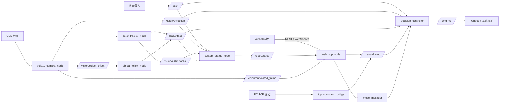

# ROS2 智能小车感知与控制系统

本项目面向 Yahboom ROSMASTER X3 四轮麦克纳姆智能小车，基于 ROS2 Humble 构建感知、决策、安全控制与 Web 运维控制台。底盘接入、激光雷达安全控制、YOLO11 视觉识别、HSV 颜色追踪、网页遥控和状态展示已有 Jetson 实车运行记录；人物跟随已实现目标选择与控制链路，连续运动验收仍待完成。仓库同时保留人员异常检测、离线评测和 STM32 MQ2/OLED 独立模块的阶段成果。

本文档记录的是当前仓库与实车已经具备的能力，同时明确列出测试证据、能力边界和未完成工作，可作为后续项目报告中“系统设计”“功能实现”“测试分析”和“总结展望”等章节的事实依据。

更新日期：**2026-10-17**。简历展示可从以下入口阅读：

| 阅读内容 | 入口 |
| --- | --- |
| 当前全部进展、指标、复现入口与待办 | [项目进展总览](docs/项目进展总览.md) |
| 课程总结报告（在线阅读） | [项目 II 总结报告](docs/reports/项目II总结报告.md) |
| 课程总结报告（Word 原件） | [进阶式挑战性综合项目 II 总结报告.docx](docs/reports/进阶式挑战性综合项目II总结报告.docx) |
| ROS2 工程与 Web 控制台 | [ROS2 功能包](ros2_ws/src/smart_car_decision/) · [Web 控制台](web-console/) |
| 最新躺卧即时告警 Demo | [运行说明](docs/YOLO11躺卧即时告警-本地运行.md) · [入口代码](demo/yolo11_fall_demo.py) |
| 双模型实际运行视频与截图 | [演示证据归档](demo/validation/README.md) |
| 离线评测与失败案例 | [即时告警全量报告](demo/results-yolo11-fall-all-immediate/report.md) · [改进工作日志](docs/倒地检测-评测与改进工作日志.md) |
| 独立传感器模块 | [STM32 MQ2/OLED 采集与硬件验证](src/mq2/README.md) |

2026-10-17 Windows 本机软件验证：Python **171 passed，4 subtests passed**；前端 **37 passed，0 failed**；`npm ci` 与 TypeScript/Vite 生产构建通过。详细环境和命令见[验证记录](docs/项目进展总览.md#6-本次软件验证)。这些结果覆盖自动化与构建，不代表当天新增实车验收。

课程报告保留对应阶段的总结内容；当前工程状态以本页及进展总览为准。已实现代码、历史实车记录和待完成验收分别说明，不把课程目标或实施计划作为已完成成果。

本项目由团队协作开发，本展示仓库基于 [xbai55/ros2-smart-car](https://github.com/xbai55/ros2-smart-car) 继续整理，并保留原有 Git 历史。具体分工见总结报告；报告列明梁家齐负责架构、ROS2 上层控制、Web 前后端、YOLO11/ByteTrack/HSV 感知集成、交通灯数据与微调部署，以及系统联调。

## 1. 当前完成情况

| 模块 | 当前状态 | 说明 |
| --- | --- | --- |
| ROS2 底盘接入 | 已实现并实车运行 | 启动 Yahboom `Mcnamu_driver_X3`，接收 `/cmd_vel` 控制底盘 |
| 模式管理与急停 | 已实现并测试 | 支持 7 种模式；急停拥有最高控制优先级 |
| 网页手动遥控 | 已实现并测试 | 浏览器发送方向命令，`manual` 和 `mapping` 模式允许移动命令 |
| 激光雷达显示与安全停车 | 已实现并实车测试 | 显示 `/scan` 点云和前方距离，支持近障停车、减速、雷达超时停车和健康状态 |
| YOLO11 通用目标识别 | 已实现并实车运行 | 默认使用 `yolo11s.pt`，发布识别结果和标注视频帧 |
| 交通灯状态微调模型 | 已完成训练资产，待默认接入与实车验证 | 已加入 `traffic_light_yolo11s.pt` 和训练说明，当前作为下一轮低速上车验证基础 |
| 人物目标跟随 | 已实现，已有感知与安全控制链路实测 | 只选择 `person`，使用 ByteTrack ID 锁定与网页点选；当前版本连续跟随和多人交叉场景仍待实车验收 |
| HSV 颜色追踪 | 已实现并实车运行 | 支持红、绿、蓝、黄预设和自定义 HSV 范围 |
| 颜色配置保存 | 已实现并测试 | 保存在浏览器本地，刷新后重新下发到 ROS；不是 Jetson 端永久配置文件 |
| Web 状态与视频 | 已实现并测试 | 提供 REST、WebSocket、MJPEG/标注帧转发和雷达可视化 |
| Docker 工程文件 | 已提供 | 已有 Dockerfile 和运行脚本，但未完成当前版本的完整实车容器验收 |
| SLAM 与地图资产 | 代码已实现，待 Jetson 验收 | 已有 slam_toolbox 配置、建图 launch、地图保存/加载和质量报告工具 |
| 人员异常与躺卧告警 | 独立 Demo 与离线评测已实现 | 最新入口对 `fallen` 即时告警；保留规则、姿态与 PP-Human 历史对照，尚未接入 ROS2 实车 |
| STM32 MQ2/OLED | 独立采集链路已硬件验证 | 支持 ADC、估算电压、OLED 与串口；未完成气体浓度标定和小车联动 |
| Nav2 导航 | 未完成 | 不在当前扫描与建图开发范围内 |
| 机械臂抓取 | 未完成 | 不在当前软件闭环中 |

## 2. 项目边界与自研部分

Yahboom 官方工作空间提供底盘串口驱动、激光雷达驱动和部分 SLAM、导航、相机示例。本项目在这些底层驱动之上开发 ROS2 决策控制包和 Web 控制系统，不将厂商驱动描述为完全自研。YOLO11、ByteTrack、slam_toolbox、PP-Human 与 STM32 HAL 等第三方算法和库分别承担检测、跟踪、建图、动作识别及硬件支持；本项目的工作是接口封装、业务规则、安全控制、前后端集成、部署与评测。

当前主要自研内容包括：

- 多模式管理、急停、命令超时和速度比例控制；
- 雷达前方扇区计算、点云简化、坐标旋转和安全优先级控制；
- YOLO11 推理节点、交通灯颜色辅助判定、安全命令保持和交通灯状态模型训练资产；
- ByteTrack 接入、只跟随人物的目标选择、网页点选和丢失处理逻辑；
- HSV 颜色追踪、运行时阈值配置和标注图像发布；
- ROS2 状态汇总、FastAPI 服务和 React/Vite Web 控制台；
- 摄像头所有权切换，避免网页、YOLO 和颜色追踪同时抢占 `/dev/video0`；
- Jetson 原生构建、启动和部署脚本，以及配套自动化测试。
- 独立人员异常 Demo、可缓存重放的离线评测、告警事件与证据管理；
- STM32 MQ2 ADC/OLED/串口采集集成与本地构建、烧录及监视工具。

## 3. 系统总体架构



系统的核心控制原则是“安全信号优先于运动意图”。即使视觉节点持续给出人物偏移，只要急停被触发、前方距离小于停车阈值、雷达数据超时或人物偏移失效，`decision_controller` 都会输出零速度。

## 4. 软件与硬件环境

### 4.1 已验证硬件

- Yahboom ROSMASTER X3 麦克纳姆轮底盘；
- Jetson 计算平台，远程主机名为 `yahboom`；
- SLLidar 激光雷达，实车可发布 `/scan`；
- Orbbec USB 相机，视频设备为 `/dev/video0` 和 `/dev/video1`；
- CP210x 与 CH340 USB 串口设备，分别用于雷达和底盘通信。

### 4.2 软件栈

- Ubuntu + ROS2 Humble；
- Python 3、`rclpy`、OpenCV、Ultralytics YOLO；
- FastAPI、Uvicorn；
- React 19、TypeScript、Vite；
- `pytest` 与 Node.js 内置测试框架；
- Yahboom 官方 ROS2 驱动工作空间。

## 5. 目录结构

```text
ros2-smart-car/
├─ ros2_ws/src/smart_car_decision/    # 自研 ROS2 功能包
│  ├─ config/decision.yaml            # 控制、感知和 Web 参数
│  ├─ launch/bringup_all.launch.py    # 底盘、雷达与自研节点统一启动
│  ├─ models/yolo11s.pt               # 当前默认 YOLO11 通用模型权重
│  ├─ models/traffic_light_yolo11s.pt # 交通灯状态微调模型权重
│  ├─ smart_car_decision/             # Python ROS2 节点和纯逻辑模块
│  └─ web/static/                     # 兼容静态 Web 页面
├─ web-console/                       # React/Vite Web 控制台及生产构建
├─ training/traffic_light/            # 交通灯数据处理、训练指标和部署说明
├─ demo/                              # 人员异常 Demo、离线评测与证据
├─ docs/                              # 当前进展、报告与评测过程文档
├─ src/mq2/                           # 独立 STM32 MQ2/OLED 采集模块
├─ tests/                             # Python 自动化测试
├─ scripts/                           # Jetson、Docker 构建与运行脚本
├─ ros2_command/                      # 旧版 PC TCP 遥控工具
├─ Dockerfile                         # ROS2 容器环境
└─ README.md
```

## 6. ROS2 节点与职责

统一启动文件默认接入底盘、雷达两个厂商驱动入口，另外启动厂商里程计节点、`robot_state_publisher`、雷达静态 TF 和 9 个本项目节点；部分组件可通过 launch 参数关闭。

| 节点或进程 | 主要职责 | 关键输入 | 关键输出 |
| --- | --- | --- | --- |
| `Mcnamu_driver_X3` | Yahboom 底盘串口驱动 | `/cmd_vel` | 里程计、IMU 等厂商话题 |
| `sllidar_node` | 激光雷达驱动 | 雷达串口 | `/scan` |
| `base_node` / `base_node_X3` | 厂商底盘里程计与 odom TF | 厂商底盘反馈 | `/odom`、TF |
| `robot_state_publisher` | 发布厂商 URDF 中的机器人 TF | X3 URDF | TF |
| `base_to_scan_laser_static_tf` | 发布当前扫描 frame 的安装关系 | launch 中的安装参数 | `base_link → laser` |
| `mode_manager` | 模式和急停状态管理 | `/robot/mode/set`、`/robot/emergency_stop/set` | `/robot/mode`、`/robot/emergency_stop` |
| `decision_controller` | 安全仲裁和运动决策 | 雷达、视觉、手动命令、模式 | `/cmd_vel` |
| `laser_obstacle_monitor` | 输出辅助前方障碍布尔量 | `/scan` | `/obstacle/front` |
| `yolo11_camera_node` | YOLO11 推理、人物偏移和标注帧 | 相机、`/robot/mode` | `/vision/detection`、`/vision/object_offset`、`/vision/annotated_frame` |
| `color_tracker_node` | HSV 分割、颜色质心和标注帧 | 相机、颜色配置、模式 | `/vision/color_target`、`/lane/offset`、标注帧 |
| `object_follow_node` | 将有效人物偏移接入统一控制接口 | `/vision/object_offset`、模式 | `/lane/offset` |
| `system_status_node` | 汇总感知和运行状态 | 雷达、视觉、模式、速度 | `/robot/status` |
| `web_app_node` | REST、WebSocket、视频与网页服务 | `/robot/status`、标注帧 | 模式、急停、速度、颜色配置和手动命令 |
| `tcp_command_bridge` | 兼容旧 PC 遥控程序 | TCP 9999 | `/manual_cmd` |

## 7. 工作模式

| 模式 | 当前行为 |
| --- | --- |
| `stop` | 始终输出零速度，适合待机和调试 |
| `manual` | 接受网页或 TCP 手动命令；命令超过 0.7 秒未刷新则停车 |
| `auto` | 根据 YOLO 语义结果执行停车、减速或直行，同时受雷达安全层约束 |
| `color_track` | 根据颜色目标横向偏移低速前进和转向；目标偏移失效则停车 |
| `object_follow` | 只跟随 `person`，根据人物中心偏移低速前进和转向 |
| `mapping` | 接受网页或 TCP 手动命令，通过统一安全控制器发布 `/cmd_vel`；雷达或命令超时则停车 |
| `navigation` | 当前不直接发布运动速度，尚未接入完整 Nav2 目标导航闭环 |

## 8. 核心功能与算法

### 8.1 安全仲裁

控制优先级从高到低为：

1. 急停或 `stop` 模式；
2. `auto`、`color_track`、`object_follow`、`mapping` 模式下雷达数据超时；
3. 达到当前模式已启用的前方障碍停车阈值；
4. 前方障碍减速；
5. 手动、YOLO、颜色或人物跟随运动意图。

主要参数如下：

| 参数 | 当前值 | 作用 |
| --- | ---: | --- |
| `obstacle_stop_distance` | 0.45 m | 未单独配置模式时使用的近障停车阈值 |
| `mode_obstacle_stop_distances` | 按模式配置 | `auto`、`color_track`、`object_follow` 默认 0.45 m；`manual`、`mapping` 默认 0，表示不启用该模式近障强制停车 |
| `obstacle_slow_distance` | 0.75 m | 前方距离位于停车线之外但仍较近时降速 |
| `scan_timeout_sec` | 0.6 s | 自动、颜色追踪、人物跟随及建图模式下，雷达超时即停车 |
| `command_timeout_sec` | 0.7 s | 手动命令超时停车 |
| `lane_timeout_sec` | 0.5 s | 颜色或人物偏移超时停车 |
| `cruise_speed` | 0.28 m/s | 自动模式基础巡航速度 |
| `slow_speed` | 0.12 m/s | 跟随或近障时的基础低速 |
| `publish_rate_hz` | 20 Hz | 决策控制输出频率 |

网页还提供 `speed_scale` 速度比例。当前下限为 15%，用于防止滑块为零时产生“按钮正常但车辆完全不响应”的误判；最终速度仍然受急停、适用模式的雷达超时及已启用的近障阈值约束。`manual`、`mapping` 默认关闭近障强制停车，不能据此声称所有模式在 0.45 m 内都会自动停车。

### 8.2 雷达前方距离与点云显示

实车雷达安装方向与最初代码假设相反，车头对应激光坐标约 180°。当前系统使用：

- `front_center_deg = 180°` 作为车头中心；
- `front_angle_deg = 35°` 作为左右前方扇区范围；
- 前方有效距离的 20% 低分位值作为安全距离，避免单个异常近点频繁触发急停；
- 对点云坐标旋转 180°，使 Web 雷达图中的“上方”与真实车头一致；
- 过滤 `NaN`、无穷值以及量程之外的数据，再最多抽取 96 个点用于网页显示。

例如，前方扇区包含 `[0.08, 1.00, 1.10, 1.20, 1.30] m` 时，单纯取最小值会被 0.08 m 噪声影响；采用低分位统计后会得到约 1.00 m，更接近连续障碍面的真实距离。

### 8.3 YOLO11 识别与自动控制

YOLO 节点只在 `auto` 和 `object_follow` 模式下占用相机，其他模式会释放设备。当前默认运行模型仍为通用 `yolo11s.pt`，置信度阈值为 0.35，推理目标频率为 10 Hz。

`auto` 模式中的类别规则包括：

- 停车标志、遮挡严重画面：停车；
- 行人、汽车、卡车、公交车、摩托车和自行车：减速；
- 交通灯：在检测框内进一步使用 HSV 比例判断红灯或绿灯；
- 未识别或无关类别：归一化为 `no_light`，不会因为偶发漏检直接反复切换到停车；
- 安全命令保持 0.8 秒，降低检测帧抖动造成的控制跳变。

仓库同时加入了第一版交通灯状态微调模型 `traffic_light_yolo11s.pt`，对应类别为 `red_light`、`yellow_light`、`green_light`、`off_light` 和 `unknown_light`。该模型基于公开道路数据训练，验证集整体指标为 `Precision 0.904 / Recall 0.789 / mAP50 0.840 / mAP50-95 0.486`，训练过程和数据说明见 `training/traffic_light/README.md`。

需要注意的是，当前默认 `decision.yaml` 仍加载通用 `yolo11s.pt`，因此实车运行链路仍是“通用交通灯检测 + HSV 颜色辅助判断”。`traffic_light_yolo11s.pt` 已经具备低速上车验证基础，但还需要同步模型配置、类别到控制命令的映射、连续帧滤波和实车误检记录后，才能写成正式默认方案。可以把它理解为“模型训练这一步完成了，但车辆闭环默认开关还没有切过去”。

### 8.4 只跟随人物的目标选择

`object_follow` 模式不会跟随汽车、动物或其他一般物体，只处理 YOLO 的 `person` 类。

目标确定过程如下：

1. 没有锁定目标时，从人物检测框中优先选择置信度较高的人；置信度相同时优先选择靠近画面中心的人；
2. 锁定后优先按 ByteTrack `track_id` 继续匹配，不再每帧重新选择置信度最高的人；
3. 没有跟踪 ID 的兼容输入使用中心距离回退，新检测框与原目标中心的跳变量不得超过画面宽度的 30%；
4. 目标短时丢失时不立即切换旁人，也不发布虚假偏移；
5. 自动模式丢失超过 0.8 秒后解除锁定并允许重新选择；网页点选的手动目标丢失后保持等待，不会自动改跟旁人。接口与操作见第 15 节。

人物框中心相对画面中心的归一化偏移为：

```text
offset = (person_center_x - frame_center_x) / frame_half_width
```

偏移范围约为 `[-1, 1]`。负值表示人物在画面左侧，正值表示人物在右侧。控制器用比例控制计算角速度，同时以低速向前运动。雷达停车优先级始终高于人物偏移，因此人物在前方但障碍距离过近时，小车仍保持静止。

历史实车记录已验证以下人物跟随链路：YOLO 独占相机、标注帧约 9.6～10.2 FPS、持续发布人物偏移、`object_follow_node` 转发偏移、控制器接收偏移并在近障条件下正确输出零速度。这些记录不等于当前 ByteTrack 版本已完成连续行驶或多人交叉场景验收。

### 8.5 HSV 颜色追踪与配置保存

颜色追踪节点对图像执行 HSV 阈值分割，通过掩膜矩计算目标面积和质心，并发布：

- 是否找到目标；
- 目标相对画面中心的横向偏移；
- 掩膜面积；
- 当前 HSV 上下界；
- 带质心和状态文字的标注帧。

Web 控制台提供红、绿、蓝、黄预设，也允许手动输入 HSV 范围。点击“应用配置”后，配置经 `/api/color-target` 发布到 `/vision/color_config`，颜色追踪节点无需重启即可更新阈值。

颜色配置同时保存在浏览器 `localStorage` 中。页面重新打开时会先读取本地配置并重新下发到 ROS。系统还使用由颜色名称和 HSV 数值生成的稳定键判断配置是否真的变化，避免 WebSocket 每次刷新产生新对象后，把用户正在编辑的红色配置重置成绿色。

需要注意：颜色配置目前是“浏览器级保存”，不是 Jetson 端配置文件永久保存。清除浏览器数据、换一台设备或在浏览器尚未连接时重启系统，后端仍会先使用 `decision.yaml` 中的默认绿色。

颜色追踪相机默认请求 V4L2 + MJPG、1280 x 720、30 FPS，并将标注 JPEG 质量提高到 82。这个改动主要解决实车颜色追踪画面发糊、帧尺寸偏低的问题；同时 Web 视频使用铺满画面的方式显示，避免操作时看到明显黑边或缩小预览。

### 8.6 摄像头所有权管理

`/dev/video0` 不能被多个 OpenCV 进程稳定地同时打开，因此系统按模式划分相机所有权：

- `stop`、`manual` 等非视觉模式：Web 节点可以直接读取相机预览；
- `auto`、`object_follow`：YOLO 节点占用相机并发布 `/vision/annotated_frame`；
- `color_track`：颜色追踪节点占用相机并发布同一标注帧话题；
- Web 页面在视觉模式下不再直接抢占相机，只转发视觉节点发布的 JPEG 标注帧。

这一结构解决了网页预览和 YOLO 同时打开 `/dev/video0` 导致的 `Device is busy` 问题。

## 9. Web 控制台

实车访问地址：

```text
http://192.168.1.104:8080
```

主要功能包括：

- 模式切换、急停和解除急停；
- 手动前后、平移和原地转向；
- 速度比例设置；
- YOLO/颜色标注视频显示；
- 前方距离和雷达点云显示；
- YOLO 结果、人物或颜色偏移、最后命令显示；
- HSV 颜色预设、自定义阈值和本地保存；
- 节点、相机、连接状态和原始 JSON 查看；
- WebSocket 状态更新与断线后的 HTTP/重连处理。
- 人物目标点选、自动选择与锁定状态展示；
- 建图状态、地图快照和位姿展示、建图重启及地图保存接口（实车建图闭环待验收）。

### 9.1 REST 接口

| 方法 | 路径 | 功能 |
| --- | --- | --- |
| GET | `/api/status` | 获取当前系统状态 |
| POST | `/api/mode` | 设置工作模式 |
| POST | `/api/command` | 发送手动控制命令 |
| POST | `/api/emergency-stop` | 设置或解除急停 |
| POST | `/api/speed` | 设置速度比例 |
| POST | `/api/color-target` | 设置 HSV 颜色配置 |
| POST | `/api/tracking-target` | 自动选择或点选人物目标 |
| POST | `/api/mode-obstacle-stop-distance` | 调整指定模式的近障停车阈值 |
| GET | `/api/map` | 获取当前地图快照 |
| POST | `/api/mapping/restart` | 检查前提后重启建图 |
| POST | `/api/mapping/save` | 保存地图快照 |
| GET | `/video_feed` | 获取 MJPEG 视频流 |

WebSocket 接口包括 `/ws/status` 和 `/ws/control`，分别用于实时状态推送和低延迟手动命令。

## 10. 构建与运行

### 10.1 Jetson 原生运行

```bash
cd ~/ros2-smart-car
bash scripts/build_jetson.sh
bash scripts/run_jetson.sh
```

`run_jetson.sh` 会加载 ROS2 Humble、本项目工作空间和 Yahboom 常见工作空间，然后启动底盘驱动、SLLidar 和全部自研节点。系统默认模式为 `stop`。

### 10.2 常用检查命令

```bash
export ROS_DOMAIN_ID=77
ros2 node list
ros2 topic list
ros2 topic echo /robot/status
ros2 topic echo /cmd_vel
ros2 topic hz /scan
ros2 topic hz /vision/annotated_frame
```

### 10.3 Jetson 建图

构建后先检查扫描、里程计、TF 和 SLAM 包：

```bash
bash scripts/check_mapping_prereqs.sh
```

启动建图前核对 `base_link → laser` 的发布者与实测安装位姿。当前 `bringup_all.launch.py` 默认启用 `publish_scan_laser_tf` 静态 TF，而 `mapping.launch.py` 另提供默认关闭的 `publish_laser_tf`；不得同时为同一个 frame 关系启用第二个发布者。

```bash
ros2 launch smart_car_decision mapping.launch.py
```

`mapping.launch.py` 的可选静态 TF 参数包括 `laser_x`、`laser_y`、`laser_z`、`laser_yaw`；仅在确认已有发布者关闭或关系确实缺失后，按实际安装值配置，不能把默认或示例位姿当作现场标定结果。

建图模式仍由 `decision_controller` 唯一发布最终 `/cmd_vel`。使用 Web 将模式切换为 `mapping` 后低速遥控；急停、雷达超时和命令超时会停车。当前 `mapping` 近障停车阈值默认为 0；如需近障强制停车，应先配置该模式阈值并确认生效。

录制和回放建图输入：

```bash
bash scripts/record_lidar_bag.sh bags/lab-20260621
bash scripts/replay_lidar_bag.sh bags/lab-20260621
```

保存、检查和重新加载地图：

```bash
ros2 run smart_car_decision map_asset save lab-20260621 \
  --site engineering-lab --bag-path bags/lab-20260621
ros2 run smart_car_decision map_asset inspect maps/lab-20260621/map.yaml
ros2 launch smart_car_decision map_view.launch.py \
  map:=$PWD/maps/lab-20260621/map.yaml
```

### 10.4 PC 旧版遥控工具

```bash
python ros2_command/pc.py --host 192.168.1.104 --port 9999
```

支持 `forward`、`backward`、`left`、`right`、`turn_l`、`turn_r` 和 `stop`。这些命令经 `tcp_command_bridge` 转换为 `/manual_cmd`。

### 10.5 Docker

仓库提供 `Dockerfile`、`scripts/build_jetson.sh` 和 `scripts/run_docker.sh`。容器使用 host 网络和设备映射，以便访问 ROS2 网络、相机和串口。当前建议优先使用已经完成实车验证的 Jetson 原生运行方式。

## 11. 自动化测试

2026-10-17 已在 Windows 本机完成当前工作区的软件检查：Python `171 passed, 4 subtests passed`，Node 前端测试 `37 passed, 0 failed`，依赖安装与生产构建通过。环境和完整命令见[项目进展总览第 6 节](docs/项目进展总览.md#6-本次软件验证)。后面的旧计数仅作历史追溯。

### 11.1 Python 测试

当前测试命令：

```bash
PYTHONPATH=ros2_ws/src/smart_car_decision python -m pytest -q
```

以下为原有阶段测试记录，保留用于追溯，**不是本次整理后完整工作区的最新测试计数**：

```text
78 passed
```

现有测试覆盖以下方面；新增 Demo 与评测测试也位于 `tests/`：

| 测试组 | 覆盖内容 |
| --- | --- |
| 颜色配置 | HSV 数值限幅、状态存储、刷新后重新下发 |
| 控制策略 | 非法模式、停止模式、急停、手动命令超时、近障停车、识别超时、速度比例、人物偏移转向、雷达超时停车 |
| 人物锁定 | 忽略非人物类别、初次选择、检测顺序变化时保持目标、丢失超时后重新选择 |
| 雷达处理 | 无效距离过滤、点云投影、180° 前方扇区、跨 ±π 角度、低分位抗噪、空扇区、显示坐标旋转 |
| 雷达健康 | 扫描频率、数据年龄、有效率、未收到、过期和恢复状态 |
| 建图配置 | mapping 安全遥控、SLAM 参数、依赖、launch 和静态 TF 开关 |
| 地图资产 | 地图 ID、PGM 质量统计、元数据、地图加载和生命周期管理 |
| YOLO 决策 | 遮挡画面停车、未知类别归一化、安全命令短时保持 |
| Web 状态 | 非法模式拒绝、非手动模式拒绝手动命令、急停状态更新 |
| 视频流 | 标注帧新鲜度、空帧和过期帧拒绝、等待新版本、视觉模式释放网页直连相机 |
| 相机参数 | 采集 FPS、目标输出 FPS 和视觉模式相机占用规则 |
| 静态资源 | 优先加载 React/Vite 生产构建目录 |

### 11.2 前端测试与构建

前端测试命令：

```bash
node --experimental-strip-types --test web-console/tests/*.test.ts
```

以下同样是原有阶段记录，不代表本次整理后的最新测试计数：

```text
33 passed
```

覆盖内容包括：

- 颜色配置跨页面刷新保存；
- 无效本地颜色数据安全回退；
- 等价 WebSocket 颜色快照使用稳定身份键，不重置编辑中的颜色；
- 模式和速度 REST 请求体；
- WebSocket 地址随 HTTP/HTTPS 和主机变化；
- 视频加载完成状态；
- 视频加载看门狗超时状态。
- 雷达健康状态和操作员提示。
- `mapping` 模式复用安全手动遥控面板。
- 地图显示降噪、位姿平滑和地图重启/保存接口。
- UI 文案防乱码、颜色预设即时应用和视频画面填充显示。

生产构建命令：

```bash
cd web-console
npm run build
```

历史记录中 TypeScript 编译和 Vite 生产构建已通过，生成的带哈希资源曾部署到 Jetson。本次仓库整理的验证结果见[项目进展总览](docs/项目进展总览.md)，不以历史构建替代当前检查。

## 12. 实车测试记录

此前阶段已记录以下实车检查；这不是 2026-10-17 对全部新增代码重新完成的实车验收：

1. SSH 登录 Jetson，确认项目目录、ROS2 包和厂商驱动可用；
2. 确认 `/dev/ttyUSB0`、`/dev/ttyUSB1`、`/dev/video0` 和 `/dev/video1` 存在；
3. 单独启动 SLLidar，成功获取 `/scan`，雷达健康状态为 `OK`，实际更新约 7～10 Hz；
4. 启动状态节点后，`front_distance` 从原先的 `null` 修复为有效米制距离；
5. 雷达点云旋转后，Web 图中的车头方向与实车一致；
6. 调用颜色接口切换到红色，等待后续状态刷新后仍保持红色；
7. 完整启动后确认底盘、雷达和 9 个自研节点均在线；
8. `stop` 模式下实测 `/cmd_vel` 的线速度和角速度全部为 0；
9. 人物跟随模式下，YOLO 独占 `/dev/video0`，标注帧约 9.6～10.2 FPS，并成功发布人物偏移；
10. 前方距离小于 0.45 m 时，即使人物偏移持续有效，`/cmd_vel` 仍保持全零；
11. Web 首页和 `/api/status` 返回 HTTP 200，生产资源已更新为最新哈希文件；
12. Jetson 端重新编译成功，远端 Python 测试为 37 项通过。

这些结果证明了“传感器输入—感知节点—决策节点—安全仲裁—状态展示”链路能够在实车上运行。需要强调的是，人物跟随的运动部分因为测试时前方存在近障，安全层正确阻止了车辆前进，因此尚不能把“长距离连续跟随效果”写成已完成验收。

## 13. 已知限制与未完成工作

### 13.1 需要优先完成

1. **人物连续运动跟随测试**：需要在空旷、无台阶场地测试直行、转向、目标横穿、短时遮挡、多人交叉和目标离开等工况，并记录轨迹、偏移和停车距离。
2. **Jetson 建图验收**：需要实测 `/odom`、TF、雷达安装位姿、闭环地图和地图重新加载；当前只能确认代码、配置和自动化测试通过。
3. **地图质量对比**：需要在实际场地完成至少两次独立建图，记录墙体连续性、重影、闭环偏差和实际尺寸误差。
4. **颜色配置后端持久化**：当前配置保存在浏览器本地。后续可在 Jetson 保存 YAML/JSON，使所有终端和系统重启前后共享同一配置。
5. **系统化 Web 视觉回归**：已完成前端单元测试、构建和 HTTP 检查，但还缺少多浏览器、手机尺寸、弱网、断线重连和长时间运行的完整自动化 UI 测试。

### 13.2 算法能力限制

- 人物锁定已接入 ByteTrack ID，兼容输入保留中心距离回退；未使用人脸识别或 ReID，长时间遮挡、离场返回及多人交叉仍可能发生 ID 变化，手动目标丢失后需重新点选；
- 默认 YOLO 运行链路仍使用通用 `yolo11s.pt`；虽然已经训练出 `traffic_light_yolo11s.pt` 并记录了 mAP、Precision、Recall 等指标，但尚未切为默认模型并完成实车闭环验收；
- 当前默认交通灯判断仍依赖检测框内 HSV 比例，复杂光照、反光和远距离小目标下需要进一步标定；微调模型后续也需要补充本车摄像头数据；
- 雷达距离参数根据当前安装方向和现场测试设置，更换安装方向后必须重新校准 `front_center_deg`；
- 当前跟随控制主要是横向比例控制，没有目标距离视觉估计、速度平滑、加速度约束和轨迹预测。

### 13.3 尚未形成完整闭环的项目目标

- SLAM 和地图资产代码已实现，但 Jetson 建图、地图质量评估和 Web 地图图像展示尚未完成实车闭环；
- Nav2 定位、目标点下发、全局/局部规划和动态避障闭环；
- 深度相机点云、三维障碍距离和视觉—雷达外参标定；
- 机械臂检测、定位、抓取和底盘协同；
- Docker 版本在当前 Jetson 硬件上的完整传感器、GPU、网络和长期稳定性验收；
- 自动启动服务、进程崩溃恢复、日志轮转和运行健康监控；
- Web 登录认证、权限控制和局域网以外的安全访问；
- GitHub Actions 等持续集成流程。

## 14. 项目报告撰写建议

后续项目报告可以按以下事实组织：

- “总体设计”使用第 3 节架构图和第 6 节节点表；
- “关键技术”重点展开安全仲裁、雷达低分位距离、人物跨帧锁定、HSV 在线配置和摄像头所有权管理；
- “系统实现”按 ROS2 节点、Web 后端、前端控制台和 Jetson 部署分层描述；
- “测试与分析”引用第 11 节自动化测试和第 12 节实车测试，不要把未完成的连续跟随、SLAM 或机械臂写成已验收；
- “不足与展望”可直接基于第 13 节展开，并补充后续实测数据、截图、轨迹曲线和识别指标。

在报告中应始终区分厂商底层驱动与本项目自研模块，避免把 Yahboom 已提供的底盘、雷达、SLAM 或导航示例全部描述为自主开发成果。

## 15. ByteTrack 特定人物跟随

`object_follow` 模式使用 Ultralytics 内置 ByteTrack，只跟踪 YOLO11 的 `person` 类。ByteTrack 没有独立模型权重，系统继续使用 `models/yolo11s.pt`。

目标选择规则：

1. 默认自动选择置信度较高且靠近画面中心的人，并锁定其 `track_id`；
2. 在网页切换到“目标跟随”后，可以点击视频中的人物框切换为手动锁定；
3. ByteTrack 使用高、低置信度两阶段匹配；当前 `bytetrack.yaml` 的 `track_buffer` 为 30 帧，目标选择器丢失超时另设为 0.8 秒，不能把两者混为同一固定时间保证；
4. 自动目标丢失后可以重新选择人物；手动目标丢失后停车等待，不会自动误跟旁人；
5. 点击“自动选择”按钮可退出手动等待状态。

目标选择接口为 `POST /api/tracking-target`。自动选择载荷为 `{"action":"auto"}`；点击选择载荷为 `{"action":"select","x":0.42,"y":0.55}`，其中坐标相对于原始视频画面归一化。ROS2 对应话题为 `/vision/tracking_target/set`，状态发布到 `/vision/tracking_target`。

标注视频会以黄色粗框和 `LOCKED ID` 突出当前目标。ByteTrack 不提供人脸识别；人物长时间离场再返回时，需要重新点击选择。

## 16. 人员异常检测与最新躺卧告警

最新入口为 [`demo/yolo11_fall_demo.py`](demo/yolo11_fall_demo.py)：保留通用 YOLO11 检测，另用跌倒专用权重对 `fallen >= 0.25` 即时产生场景告警，不等待 2 秒、不依赖跟踪 ID，也不使用飞桨运行时。支持视频或摄像头、声音提示、逐帧回看、事件 JSONL、截图、运行摘要与可选标注视频。完整步骤见[本地运行说明](docs/YOLO11躺卧即时告警-本地运行.md)。这是独立 Windows/CUDA Demo，尚未集成进 ROS2 节点、Web 告警页或小车安全控制闭环。

本地 URFD 全量评测为 **69 段、11,756 帧**：真实跌倒片段命中 **28/30**，全部躺卧片段命中 **40/46**，普通活动误报 **12/23**；躺卧帧召回率 **40.7%**、帧级精确率 **72.0%**。片段命中要求至少覆盖一个官方躺卧标注帧，不能将其写成“实车准确率 93.3%”。权重训练集与 URFD 重叠情况未知，当前误报与漏框仍明显。参见[完整结果和限制](demo/results-yolo11-fall-all-immediate/report.md)。

历史规则、YOLO姿态、PP-Human 与确认 2 秒策略的脚本、报告及失败案例一并保留，便于追踪技术选择；当前入口以本节为准。[Demo 目录](demo/)和[改进日志](docs/倒地检测-评测与改进工作日志.md)包含详细过程。数据集、模型下载缓存、虚拟环境和运行生成物不随普通 Git 提交发布，复现时需按说明准备。

## 17. 独立 STM32 MQ2/OLED 模块

[`src/mq2/`](src/mq2/)包含 STM32F103C8T6 固件、本地构建和 CH340 烧录脚本、串口监视器及接线说明。每 500 ms 采集 ADC，并向 OLED 与 USART1 输出原始值及按 3.3 V 参考电压估算的 A0 电压。已有硬件烧录、回读、连续串口读数及 OLED 显示记录，详见[模块说明](src/mq2/README.md)。

该模块尚未完成气体浓度标定，显示 `PPM: NOT CAL`；历史 3 V 供电测试只证明采集和通信链路工作，不代表 MQ2 正常加热条件下的灵敏度或烟雾报警性能。它尚未接入小车 ROS2 状态与告警系统。
