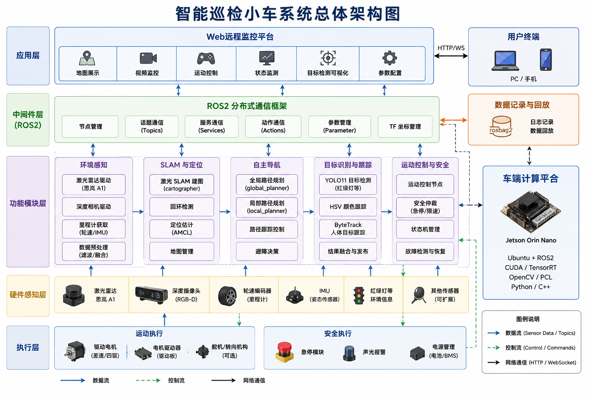

# 进阶式挑战性综合项目II总结报告

> 本页为上传报告的完整正文阅读版，保留原文叙述、章节编号、表格、代码与内嵌图片。原文中的完成状态及测试数量属于报告记录，当前实现与验证边界请结合[仓库说明](../../README.md)阅读。

[下载原始 Word 报告](进阶式挑战性综合项目II总结报告.docx)

## 摘 要

随着人工智能、机器人技术和自动驾驶技术的快速发展，智能移动机器人在智慧物流、智能巡检、无人配送等领域得到了广泛应用。针对传统移动机器人环境感知能力不足、目标识别精度有限以及人机交互方式单一等问题，本组设计并实现了一套基于ROS2的智能巡检小车系统。

本系统以Jetson Orin Nano为核心控制平台，构建了集环境感知、地图构建、自主导航、目标检测与远程监控于一体的智能小车平台。在硬件方面，系统集成思岚A1激光雷达、深度摄像头、电机驱动模块及多种传感器，实现对周围环境信息的实时采集；在软件方面，基于ROS2构建分布式机器人通信框架，利用SLAM技术完成环境地图构建与定位，结合导航算法实现自主路径规划与避障控制。同时，针对实际应用场景中的目标识别需求，采用YOLO目标检测算法进行模型训练与优化，通过构建专用数据集并开展迁移学习，实现对目标物体的高效识别与实时检测。

为提升系统的可视化管理能力，设计并开发了基于Web的远程监控平台，实现地图展示、视频监控、运动控制、状态监测及目标检测结果可视化等功能，使用户能够实时掌握小车运行状态并进行远程交互控制。系统经过建图测试、导航测试、目标检测测试及综合场景验证，结果表明该系统能够稳定完成环境感知、自主导航和目标识别等任务，具有良好的实时性、稳定性和扩展能力。

本设计实现了智能小车从底层硬件驱动到上层应用服务的完整技术链路，为智能巡检、无人配送及移动机器人相关应用提供了可行的解决方案和实践参考。

关键词：ROS2；SLAM；HSV ；YOLO目标检测；Web可视化

## 目 录

以下保留原报告目录及其印刷页码。

| 原报告目录 | 印刷页码 |
| --- | --- |
| 第一章 项目概述 | 1 |
| 1.1 项目背景 | 1 |
| 1.2 建设目标 | 1 |
| 1.3 需求与边界 | 2 |
| 1.4 项目边界与真实实现依据 | 3 |
| 第二章 系统设计 | 4 |
| 2.1 总体架构设计 | 4 |
| 2.2 数据流与控制流设计 | 6 |
| 2.3 工程边界与可扩展设计 | 7 |
| 2.4 系统边界 | 9 |
| 2.5 工程闭环设计 | 9 |
| 2.6 安全优先设计 | 10 |
| 第三章 关键技术实现 | 11 |
| 3.1 智能车运动控制与安全仲裁 | 11 |
| 3.2 激光雷达避障算法 | 14 |
| 3.3 YOLO11红绿灯识别与模型微调 | 16 |
| 3.4 HSV颜色跟踪算法 | 19 |
| 3.5 ByteTrack人体目标跟踪 | 21 |
| 3.6 激光SLAM建图算法 | 23 |
| 3.7 车端工程部署与资源优化 | 27 |
| 3.8 Web远程控制与状态展示 | 28 |
| 3.9 车端模块联调与关键代码 | 29 |
| 3.10 运行验证命令与测试入口 | 33 |
| 3.11 本章小结 | 33 |
| 第四章 系统测试与结果分析 | 35 |
| 4.1 测试方案 | 35 |
| 4.2 车端测试用例与参数校准 | 36 |
| 4.3 测试用例设计 | 39 |
| 4.5 结果分析 | 42 |
| 第五章 创新点与应用价值 | 45 |
| 5.1 创新点概述 | 45 |
| 5.2 项目特色 | 46 |
| 5.3 应用价值 | 47 |
| 5.4 核心创新设计分析 | 48 |
| 5.5 应用场景分析 | 51 |
| 第六章 问题分析与未来展望 | 52 |
| 6.1 典型问题与解决过程 | 52 |
| 6.2 控制系统完善方向 | 56 |
| 第七章 总结与分工协作 | 59 |
| 7.1 项目总结 | 59 |
| 7.2 分工协作 | 60 |
| 参考文献 | 62 |
| 致谢 | 63 |

## 第一章 项目概述

### 1.1 项目背景

移动机器人课程项目需要底盘、雷达和相机协同运行，并要求小车在多源输入同时存在时仍能做出可解释、可验证的运动决策。实际调试中，常见问题集中在车辆运动原因、识别状态与停车逻辑、手动指令有效性等控制链路环节。因此，项目围绕 ROS2 智能小车上层控制系统展开：以感知数据为输入，以统一安全决策为核心，以 /cmd_vel 为最终速度输出。

从行业背景看，移动机器人正在从单一执行设备发展为“感知—决策—控制”一体化系统。International Federation of Robotics 在 World Robotics 2025 报告中给出的数据表明，2024 年全球工业机器人安装量约为 542000 台，中国占全球部署量的 54%；专业服务机器人销量接近 200000 台，其中运输与物流类约 102900 台。相关数据说明，机器人系统的工程能力正在更多地落到移动平台、物流搬运和安全运行场景中。

本项目选用 Yahboom ROSMASTER X3 智能小车作为载体。该平台具备麦克纳姆轮底盘、激光雷达、USB 相机和 Jetson 计算环境，适合验证室内移动机器人中的典型控制任务。项目自研 ROS2 上层功能包，围绕模式管理、雷达安全距离、视觉目标跟随、颜色目标追踪和速度仲裁进行设计。与单纯展示识别结果不同，本项目关注识别结果如何进入控制器、控制器如何判断是否允许运动、以及安全条件如何覆盖一般运动意图。

### 1.2 建设目标

本项目的建设目标是完成一个可运行、可测试、可解释的 ROS2 智能小车控制系统。系统需要接入 ROSMASTER X3 底盘和激光雷达，能够通过统一决策节点发布 /cmd_vel，并在手动控制、自动识别、颜色追踪和人物跟随等模式下保持清晰的控制边界。

在功能层面，项目完成多模式切换、急停控制、手动速度指令、雷达近障停车、雷达超时停车、YOLO11 目标识别、ByteTrack 人物锁定、HSV 颜色追踪和状态观测。各功能不直接抢占底盘控制权，并把运动意图交给 decision_controller 统一处理。在典型场景中，人物跟随节点只提供横向偏移和有效性，真正的前进、转向和停车由决策控制器结合雷达距离后决定。

在工程层面，项目目标是让控制参数、感知参数和安全阈值可配置、可复验。decision.yaml 中集中保存停车距离、减速距离、雷达超时、手动命令超时、人物锁定时间、模型置信度和相机参数；测试目录中通过自动化用例约束控制策略，减少修改节点代码后破坏安全优先级。

### 1.3 需求与边界

从使用需求看，项目需要让智能小车在室内低速场景中完成可控运动和安全响应。操作者能够通过调试端切换停止、手动、自动、颜色追踪和人物跟随等模式，系统能够把这些模式转换为明确的 ROS2 状态，并最终由统一控制器输出到底盘速度话题。该设计使不同输入同时存在时仍能明确车辆控制来源和强制停车条件。

从安全需求看，急停、雷达近障和数据超时必须优先于一般运动意图。比如手动端持续发送前进命令时，如果前方距离低于停车阈值，车辆仍应输出零速度；人物跟随检测到目标时，如果雷达数据长时间没有更新，也不能继续按照旧目标前进。因此，安全需求既包括显式急停按钮，也包括传感器新鲜度、距离阈值和命令超时等隐含约束。

从感知需求看，雷达、YOLO11、ByteTrack 和 HSV 颜色分割都需要把复杂原始数据转化为控制层可使用的简洁信息。雷达提供前方距离和点云概览，YOLO 输出交通灯或人物目标，ByteTrack 维持人物身份连续性，颜色追踪输出目标中心偏移。这些结果不直接控制电机，并作为运动意图或安全状态交给 decision_controller 统一判断。

系统基于 ROSMASTER X3 底层驱动、雷达驱动和基础硬件接口进行上层开发，主要完成车端控制、感知处理、安全仲裁、状态汇总和调试支撑等软件功能。SLAM 建图用于生成环境地图并支撑后续导航扩展，Web 平台主要承担状态监测、远程控制和参数配置功能，模型微调用于提升特定目标识别效果。项目成果集中体现为基于既有硬件平台的 ROS2 上层控制系统与感知协同能力。

### 1.4 项目边界与真实实现依据

系统开发边界为：ROSMASTER X3 底盘驱动、思岚雷达驱动和部分底层硬件接口复用 Yahboom 及 ROS2 生态；项目主要工作集中在 ROS2 上层功能包、统一运动决策、目标检测与跟踪、雷达安全处理、建图配置、Web 远程控制和 Jetson 部署流程。该划分体现了课程设计中完成的软件系统集成工作。

从实际实现看，系统已经形成“感知输入—ROS2 话题—安全仲裁—底盘执行—Web 反馈”的闭环。雷达发布 /scan，视觉节点发布 /vision/detection、/vision/object_offset 和 /vision/annotated_frame，Web 节点发布模式、急停和手动命令，decision_controller 统一发布 /cmd_vel。该链路构成系统功能实现的主要依据。

系统功能边界按当前课程项目的实际实现组织：核心成果集中在ROS2上层控制、目标检测与跟踪、雷达安全处理、建图配置、Web远程控制和Jetson部署流程；扩展功能在总体设计中作为系统可扩展能力说明。

系统需求可以分为运动控制需求、安全需求、感知需求和调试需求。运动控制方面，小车应支持停止、手动、自动、颜色追踪和人物跟随等模式，并保证不同模式下速度来源清晰。安全方面，急停必须拥有最高优先级，雷达超时和近障条件必须能够覆盖一般运动意图。感知方面，系统需要从雷达、YOLO 和 HSV 颜色分割中提取可用于控制的简洁状态，而不是只停留在画面展示。调试方面，系统需要提供必要的模式、速度、雷达距离和目标状态观察能力。

系统基于厂商底盘驱动、雷达驱动和基础硬件接口开展二次开发，主要工作集中在 ROS2 上层功能包、控制策略、感知结果到运动意图的转换、参数化配置和自动化测试。Web 平台定位为调试控制台，用于状态观察、模式切换、参数下发和运行验证。

这一边界使系统说明能够围绕“车为什么动、为什么停、怎样保证不误动”展开。手动模式下，调试页面或 TCP 只负责产生 /manual_cmd，超过 0.7 秒未刷新则停车；人物跟随模式下，YOLO 和 ByteTrack 只负责给出人物偏移，前方距离小于 0.45 m 时仍由安全层输出零速度。相关场景体现了系统对控制安全的优先考虑。

## 第二章 系统设计

### 2.1 总体架构设计

#### 2.1.1 五层系统架构补充说明

根据系统总体架构图，智能巡检小车采用五层结构组织，分别为应用层、中间件层、功能模块层、硬件感知层和执行层。五层结构将用户交互、ROS2 通信、算法功能、传感器输入和底盘执行分开描述，使系统中每一类模块的职责更加清楚。

应用层对应 Web 远程监控平台和用户终端。PC 或手机通过 HTTP/WebSocket 与车端服务通信，完成地图展示、视频监控、运动控制、状态监测、目标检测可视化和参数配置等操作。该层只负责交互和可视化，不直接绕过 ROS2 控制底盘；其中页面点击前进按钮后，系统只是形成控制意图，最终速度仍由车端安全仲裁决定。

中间件层对应 ROS2 分布式通信框架，承担节点管理、话题通信、服务通信、动作通信、参数管理和 TF 坐标管理等任务。应用层下发的模式、急停、参数配置和目标选择请求，需要在这一层转换为 ROS2 节点能够理解的消息；传感器和算法模块产生的数据，也通过话题、服务或 TF 关系向上汇总。该层承担系统的数据与控制通道，使各模块不必直接耦合在一起。

功能模块层是本项目的软件主体，按照架构图可划分为环境感知、SLAM 与定位、自主导航、目标识别与跟踪、运动控制与安全五类模块。环境感知负责接收激光雷达、深度相机、里程计和 IMU 等输入并完成滤波融合；SLAM 与定位负责激光建图、回环检测、定位估计和地图管理；自主导航预留全局路径规划、局部路径规划、路径跟踪和避障决策能力；目标识别与跟踪负责 YOLO11 目标检测、HSV 颜色跟踪、ByteTrack 人体目标跟踪和结果发布；运动控制与安全负责运动控制节点、安全仲裁、状态机管理以及故障检测与恢复。

硬件感知层提供真实环境输入，包括激光雷达、深度摄像头、轮速编码器、IMU、红绿灯等环境信息以及其他可扩展传感器。这一层的数据沿蓝色数据流进入上层功能模块，其中雷达数据进入环境感知与 SLAM，摄像头数据进入目标识别与跟踪，轮速和 IMU 信息可用于定位估计。

执行层负责把控制命令落实到物理设备，主要包括驱动电机、电机驱动器、舵机或转向机构，以及急停模块、声光报警和电源管理等安全执行单元。绿色控制流从运动控制与安全模块下发到底盘和安全设备，保证车辆运动、急停、限速和故障处理都在统一控制链路中完成。

从数据流看，传感器数据先进入功能模块层，经 ROS2 中间件分发到建图、识别、跟踪和控制节点，再由应用层展示给用户；从控制流看，用户端或算法模块产生的运动意图需要经过 ROS2 通信和运动控制与安全模块，最终才到达执行层。该五层架构能够减少 Web、视觉或导航模块直接抢占底盘控制权，也便于后续扩展 Nav2、自主导航或更多传感器。



图2-1 智能巡检小车系统总体架构图

表2-1 五层架构职责划分

| 层级 | 主要对象 | 核心职责 | 与上下层关系 |
| --- | --- | --- | --- |
| 应用层 | Web远程监控平台、PC/手机用户端 | 地图展示、视频监控、运动控制、状态监测、目标检测可视化、参数配置 | 通过HTTP/WebSocket与车端通信，形成控制意图并展示状态 |
| 中间件层（ROS2） | 节点管理、Topics、Services、Actions、Parameter、TF | 完成数据分发、服务调用、动作交互、参数管理和坐标关系维护 | 连接应用层与车端功能模块，是系统通信骨架 |
| 功能模块层 | 环境感知、SLAM与定位、自主导航、目标识别与跟踪、运动控制与安全 | 完成感知处理、建图定位、路径规划预留、目标跟踪、统一安全仲裁 | 接收传感器数据并生成状态、地图、目标偏移和控制命令 |
| 硬件感知层 | 激光雷达、深度摄像头、轮速编码器、IMU、红绿灯等环境信息 | 采集距离、图像、里程、姿态和环境目标信息 | 向功能模块层提供真实环境数据 |
| 执行层 | 驱动电机、电机驱动器、舵机/转向机构、急停模块、声光报警、电源管理 | 执行速度、转向、急停、告警和电源保护等动作 | 接收运动控制与安全模块下发的控制命令 |

### 2.2 数据流与控制流设计

为了实现多传感器信息融合和统一运动控制，本项目采用"感知—决策—执行"三层架构设计，将数据流与控制流进行解耦。系统以 ROS2 Topic 为数据传输载体，各功能模块之间通过标准消息接口完成信息交互，既保证了模块独立性，又提高了系统的可扩展性和维护性。

在数据流方面，系统的数据来源主要包括激光雷达、视觉感知模块以及人工控制输入。激光雷达持续发布环境距离信息，经过数据筛选和前方安全区域分析后生成障碍物距离数据；YOLO11 目标检测模块输出交通灯识别结果、人物目标信息及跟随目标偏移量；HSV 颜色跟踪模块输出颜色目标位置、目标面积以及偏移信息；Web 控制端则负责发布人工控制指令及模式切换命令。上述模块均作为感知层，仅负责获取和处理环境信息，不直接参与底盘运动控制，而是统一向决策层提供运动意图和状态信息。

控制流以 decision_controller 为核心，实现系统运动指令的统一生成。控制器周期性获取当前运行模式、急停状态、雷达检测结果、视觉感知结果以及人工控制命令，并结合各类状态信息进行综合分析，最终生成唯一的底盘速度指令发布至 /cmd_vel。整个控制过程遵循统一的优先级仲裁机制，当急停触发、停止模式开启、雷达数据异常或前方存在近距离障碍物时，系统优先执行安全控制策略；只有在满足安全条件的情况下，才根据手动控制或视觉跟随等运动意图计算线速度和角速度，实现车辆正常运动。

采用统一决策架构后，各感知模块仅负责提供环境信息和运动意图，底盘控制权限集中于决策层管理，避免了多个节点同时发布速度指令造成的控制冲突。例如，在人物跟随模式下，视觉模块仅输出目标相对于车体中心的偏移信息，当检测到前方障碍物距离低于安全阈值时，决策控制器仍会优先执行停车策略，而不会继续响应视觉跟随指令。该设计实现了环境感知、运动决策和底盘执行之间的职责分离，既保证了系统控制逻辑的一致性，又提高了智能小车运行过程中的安全性、稳定性和可扩展性。

### 2.3 工程边界与可扩展设计

#### 2.3.1 参数化设计补充

decision.yaml是系统运行参数的集中入口。雷达前方扇区、停车距离、减速距离、命令超时、视觉超时、YOLO模型路径、相机分辨率、Web端口和颜色阈值都通过参数文件配置。该设计减少把关键数值散落在多个Python文件中。

雷达参数中，front_center_deg=180.0是实车安装方向调试后的结果，front_angle_deg=35.0定义前方扇区半宽，front_distance_percentile=20.0用于低分位抗噪。三个参数共同决定系统如何理解“前方”。

速度参数中，cruise_speed用于自动巡航，slow_speed用于近障或跟随，turn_speed用于手动转向，lane_kp用于将横向偏移转换为角速度，max_angular_speed用于限制转向过猛。现场测试时可通过速度比例限制整体速度，不需要修改功能代码。

#### 2.3.2 ROS2节点与Topic设计补充

ROS2节点之间通过Topic交换数据，不通过全局变量或临时文件传递核心控制信息。/scan表示雷达原始扫描，/vision/detection表示视觉识别语义，/vision/object_offset表示人物偏移，/lane/offset表示进入控制层的横向偏移，/robot/status表示系统汇总状态，/cmd_vel表示最终底盘速度命令。

Topic设计承担系统内部合同。Publisher只承诺发布某类数据，Subscriber只依赖数据语义，不需要知道对方内部如何实现。以/vision/object_offset为例，决策节点只关心偏移是否有效和偏移值大小，不关心该偏移来自YOLO、ByteTrack还是后续可能接入的其他跟踪器。

调试时也可以把Topic当成系统观察窗口。若人体跟随不生效，先看/vision/tracking_target是否显示locked，再看/vision/object_offset是否有偏移，再看/lane/offset是否被object_follow_node转发，最后看/cmd_vel是否被雷达或急停压制。这个顺序比直接猜测模型问题更可靠。

工程边界上，底盘串口协议、雷达驱动和相机底层采集复用厂商或开源能力；项目自研部分集中在上层控制策略、模式管理、雷达前方距离统计、视觉目标筛选、颜色目标偏移、状态汇总和测试用例。该设计既尊重已有硬件平台，也能把课程项目的重点放在软件系统设计与控制逻辑实现上。

可扩展设计主要体现在接口稳定和参数集中两个方面。接口上，所有运动意图统一转换为控制器能理解的模式、偏移、检测状态或手动命令；参数上，decision.yaml 集中管理停车距离、减速距离、超时时间、模型置信度、人物锁定时间和相机分辨率。模型路径、雷达安装方向和控制阈值均通过配置文件管理，减少在多个节点中分散修改。

系统已完成与车端控制闭环相关的模式管理、运动仲裁、雷达安全处理、视觉感知接入、状态汇总和调试控制等功能。SLAM 建图配置用于生成环境地图并为后续导航功能提供地图基础，当前控制闭环以安全运动控制和感知协同为主要实现内容。

### 2.4 系统边界

为保证系统结构清晰、职责明确，本项目按照"底层驱动—上层控制—应用交互"的思路划分系统边界。底层部分主要包括移动底盘驱动、激光雷达驱动、摄像头数据采集以及 ROS2 基础通信框架，依托 ROSMASTER X3 平台及相关开源软件完成设备接入和基础数据获取。

本项目的研究重点集中于车端上层控制系统的设计与实现，包括运行模式管理、多源感知信息融合、安全控制策略、视觉目标处理、运动决策以及 Web 远程监控平台等功能。系统在已有硬件平台基础上，完成了从环境感知、运动意图生成到速度指令输出的完整控制流程，实现了智能小车的多模式协同运行。

在系统架构中，Web 平台主要负责运行状态监测、参数配置和控制指令下发，不直接参与底盘运动控制。所有控制请求均需经过车端决策模块统一处理后生成最终运动指令，从而保证系统具有统一的控制入口和良好的安全性。

### 2.5 工程闭环设计

为提高系统的可靠性和可维护性，本项目构建了"参数配置—运行控制—测试验证—实车反馈"的工程闭环。系统运行所需的重要控制参数统一进行配置管理，在程序启动时完成加载，并作为各功能模块运行的重要依据，避免了参数分散配置带来的维护困难。

运行过程中，各传感器持续采集环境信息，视觉识别、雷达检测和人工控制等模块分别输出对应状态，由统一决策模块综合分析后生成运动控制指令，实现感知、决策和执行之间的闭环控制。

为了验证系统设计的正确性，项目结合功能测试、联调测试和实车实验，对目标识别、人物跟随、雷达避障、模式切换以及紧急停车等功能进行了验证。同时，通过运行日志、状态监测和测试记录等方式，对车辆运行过程中的关键状态进行跟踪分析，使系统行为具有良好的可追溯性。当车辆出现停车、减速或控制异常时，可以快速定位触发原因，提高系统调试效率和维护能力。

工程闭环的建立，使系统形成了"配置可管理、运行可监测、测试可验证、问题可追溯"的开发流程，为系统后续功能扩展和持续优化提供了保障。

### 2.6 安全优先设计

移动机器人在实际运行过程中需要兼顾功能实现与运行安全，因此，本项目将安全控制作为系统设计的最高优先级，并贯穿于整个运动控制流程。

系统采用统一控制策略，在生成底盘运动指令之前，首先对急停状态、运行模式、激光雷达数据有效性以及前方障碍物距离等安全条件进行综合判断。只有在所有安全条件满足的情况下，系统才会根据人工控制或视觉感知产生相应的运动控制指令；一旦检测到急停触发、数据异常或近距离障碍物等危险情况，系统立即停止当前运动并输出安全控制指令。

这种统一的安全仲裁机制保证了任何功能模块都不能绕过安全控制直接驱动底盘。例如，在人物跟随模式下，即使视觉模块持续检测到有效目标，当雷达检测到前方存在障碍物时，系统仍优先执行停车策略；在人工控制模式下，当控制指令长时间未更新时，车辆也会自动停止运动，避免因通信异常导致车辆持续运行。

通过建立统一的安全控制框架，系统实现了环境感知、运动控制和安全保护之间的协调统一，不仅提高了智能小车运行过程中的稳定性和可靠性，也为后续接入自主导航、路径规划等高级功能提供了统一、安全的控制基础。

## 第三章 关键技术实现

本章围绕智能小车系统的关键技术实现展开，重点介绍车端控制系统中运动控制、激光雷达避障、YOLO11 红绿灯识别、HSV 颜色跟踪、ByteTrack 人体目标跟踪、激光 SLAM 建图以及 Web 远程监控等核心功能模块的设计与实现过程，并分析各模块之间的数据交互关系和协同工作机制。

本项目以 ROS2 为软件开发框架，构建了"感知—决策—执行"的控制架构。激光雷达、视觉识别以及人工控制等模块负责采集环境信息并生成相应的运动意图，通过 ROS2 Topic 将数据发送至统一决策模块；决策模块综合运行模式、环境状态以及安全约束，对多源信息进行统一仲裁，并生成唯一的底盘运动指令，实现多模块协同控制。该架构有效避免了多个功能模块同时控制底盘而产生的指令冲突，同时保证了急停控制、雷达避障以及异常保护等安全策略始终具有最高执行优先级，提高了系统运行的安全性、稳定性和可维护性。

此外，本章结合系统实现过程，对各关键模块的核心算法、数据处理流程以及主要代码实现进行说明。为突出关键技术思路，文中仅保留与系统实现密切相关的核心代码和关键流程，适当省略日志输出、异常处理以及部分工程化配置内容，以便更加清晰地展示系统的设计方法和实现原理。

### 3.1 智能车运动控制与安全仲裁

运动控制是车端系统的最终执行出口。ROSMASTER X3底盘接收geometry_msgs/Twist消息，其中linear.x表示前后速度，linear.y表示左右平移速度，angular.z表示原地旋转角速度。上层ROS2节点不直接控制单个电机，并发布/cmd_vel，由底盘驱动完成麦克纳姆轮速度解算。

项目将decision_controller设计为唯一/cmd_vel发布节点。它订阅/scan、/vision/detection、/lane/offset、/manual_cmd、/robot/mode、/robot/emergency_stop和/robot/speed_scale等话题，把人工控制、自动识别、颜色跟踪、人体跟随和雷达安全状态整合为一条运动指令。

该结构体现了“运动意图输入”和“安全速度输出”的分离。Web 页面点击前进只会发布 /manual_cmd，颜色跟踪只会发布 /lane/offset，YOLO 只会发布 /vision/detection，最终是否运动仍由 decision_controller 结合雷达和急停判断。

控制优先级按照安全程度划分：第一层为急停和stop模式，任何情况下都输出零速度；第二层为雷达超时和前方近障停车；第三层为模式约束，其中navigation模式作为预留导航接口时保持停车输出；第四层才是手动、自动、颜色跟踪和人体跟随产生的运动意图。

在参数配置中，publish_rate_hz为20Hz，能够保证底盘速度指令持续刷新；command_timeout_sec为0.7s，防止手动命令丢失后小车继续运动；lane_timeout_sec为0.5s，防止目标跟踪丢失后仍沿旧偏移转向。

#### 3.1.1 ROS2 Topic与控制输入

控制器使用ROS2 Publisher/Subscriber完成模块解耦。/scan提供雷达距离，/vision/detection提供视觉语义，/lane/offset提供目标横向偏移，/manual_cmd提供手动方向，/robot/mode提供当前运行模式，/cmd_vel输出底盘速度。

代码 3-1 decision_controller中的订阅与发布关系

```python
self.publisher = self.create_publisher(Twist, self.cmd_vel_topic, 10)
self.create_subscription(LaserScan, self.scan_topic, self.on_scan, 10)
self.create_subscription(String, self.detection_topic, self.on_detection, 10)
self.create_subscription(Float32, self.lane_offset_topic, self.on_lane_offset, 10)
self.create_subscription(String, self.manual_cmd_topic, self.on_manual_command, 10)
self.create_subscription(String, self.mode_topic, self.on_mode, 10)
self.create_subscription(Bool, self.emergency_stop_topic, self.on_emergency_stop, 10)
self.create_timer(1.0 / self.publish_rate_hz, self.control_loop)
```

这一组订阅关系把雷达、视觉、模式和手动命令都汇入同一个决策节点，底盘速度只从这个节点发布。经过该处理，各模块可以独立产生意图，但不会直接争抢 /cmd_vel。

上述代码体现了ROS2智能车系统的典型结构：传感器节点、视觉节点和Web节点并不互相调用函数，并通过话题交换状态。该设计便于单独测试每个模块，其中只发布/lane/offset即可验证跟随控制，只播放/scan数据即可验证避障策略。

#### 3.1.2 控制策略实现

控制策略集中在decide_motion函数中。函数输入包括当前模式、急停状态、前方距离、视觉检测结果、手动命令、目标偏移和各类超时标志，输出为linear_x、linear_y、angular_z三元组。

代码 3-2 安全优先的运动决策流程

```python
if emergency_stop or mode == "stop":
    return zero_motion()
if mode in {"auto", "color_track", "object_follow", "mapping"} and not has_recent_scan:
    return zero_motion()
if active_stop_distance > 0.0 and front_distance <= active_stop_distance:
    return zero_motion()

speed = slow_speed if front_distance <= obstacle_slow_distance else cruise_speed
if mode == "color_track" and has_recent_lane:
    return _offset_follow_motion(lane_offset, slow_speed, lane_kp, max_angular_speed)
if mode == "object_follow" and has_recent_lane:
    return _offset_follow_motion(lane_offset, slow_speed, lane_kp, max_angular_speed)
```

判断顺序体现了安全优先：急停、停止模式、雷达超时和近障条件先于普通运动意图执行。即使页面或视觉模块给出前进请求，底盘也必须先满足这些安全条件。

偏移跟随控制采用比例控制思想。目标位于画面左侧时offset为负，控制器输出正角速度使车头向左转；目标位于右侧时offset为正，控制器输出负角速度使车头向右转。max_angular_speed用于限制最大角速度，减少目标偏移较大时小车突然急转。

#### 3.1.3 Twist速度发布

当运动决策得到速度分量后，控制器将其写入Twist并发布到/cmd_vel。实际底盘驱动负责根据麦克纳姆轮运动学将车体速度转换为四个轮子的转速。

代码 3-3 /cmd_vel速度发布

```python
twist = Twist()
twist.linear.x = motion["linear_x"]
twist.linear.y = motion["linear_y"]
twist.angular.z = motion["angular_z"]
self.publisher.publish(twist)
```

该部分展示速度发布的核心路径：控制器只负责给出车体速度，底盘驱动再完成轮速解算。该设计可以把上层决策和底层电机控制分开。

项目在decision.yaml中设置cruise_speed为0.28m/s，slow_speed为0.12m/s，turn_speed为1.0rad/s，同时提供speed_scale话题用于现场降速。现场调试时通过speed_scale限制初始速度，在雷达、视觉和控制逻辑稳定后提高速度比例。

### 3.2 激光雷达避障算法

思岚A1激光雷达负责提供二维环境距离信息。雷达驱动发布sensor_msgs/LaserScan消息，ranges数组中的每个元素表示一个角度方向上的距离，实际角度由angle_min和angle_increment计算得到。

避障算法采用“车头前方扇区”的稳健距离作为关键判断依据。由于雷达是 360 度扫描，车尾、侧方或桌腿边缘的距离不应直接触发前方停车。项目将 front_center_deg 配置为 180 度，将 front_angle_deg 配置为 35 度，即取车头方向左右 35 度范围作为危险区域。

LaserScan数据中可能包含inf、NaN或超出量程的值，这些数据不能直接参与距离统计。系统先使用range_min和range_max过滤无效数据，再对有效距离排序，取20%低分位数作为前方距离。

低分位数比最小值更适合室内小车。最小值可能被单个噪声点影响，导致误停车；平均值可能被远距离点拉高，忽略近处障碍。20%低分位数既能关注近距离危险，又能抑制孤立噪声。

#### 3.2.2 停车阈值与减速阈值

项目设置obstacle_stop_distance为0.45m，obstacle_slow_distance为0.75m。当前方距离小于0.45m时，控制器输出零速度；当前方距离在0.45m到0.75m之间时，系统进入低速控制区；大于0.75m时，允许当前模式正常运行。

不同模式可以使用不同的停车阈值。mapping模式为了便于低速建图，允许由操作人员控制运动，mode_obstacle_stop_distances中将mapping设为0.0；auto、navigation、color_track和object_follow保留0.45m停车阈值。

代码 3-4 雷达安全参数配置

```yaml
front_angle_deg: 35.0
front_center_deg: 180.0
front_distance_percentile: 20.0
obstacle_stop_distance: 0.45
obstacle_slow_distance: 0.75
mode_obstacle_stop_distances: {"auto": 0.45, "mapping": 0.0, "color_track": 0.45, "object_follow": 0.45}
```

雷达测试主要复核 front_center_deg、front_angle_deg、front_distance_percentile、obstacle_stop_distance 和 obstacle_slow_distance 等参数。通过正前方、侧方和近障三类场景观察距离变化，可以判断车头方向、扇区范围和停车阈值是否适合当前实车安装。

#### 3.2.1 LaserScan前方扇区统计

代码 3-5 front_range_statistic距离统计函数

```python
distances = []
angle = scan.angle_min
for distance in scan.ranges:
    delta = atan2(sin(angle - center_angle_rad), cos(angle - center_angle_rad))
    if abs(delta) <= half_width_rad:
        if isfinite(distance) and scan.range_min <= distance <= scan.range_max:
            distances.append(float(distance))
    angle += scan.angle_increment
distances.sort()
index = int(len(distances) * percentile / 100.0)
return distances[index]
```

该部分展示速度发布的核心路径：控制器只负责给出车体速度，底盘驱动再完成轮速解算。该设计可以把上层决策和底层电机控制分开。

这里的 atan2(sin(delta), cos(delta)) 用于把角度差归一化到 -pi 到 pi 之间。即使角度跨越 0 度边界，程序也能正确判断某个雷达点是否位于车头扇区。

#### 3.2.3 独立障碍物监测节点

除decision_controller内部使用雷达距离外，系统还保留laser_obstacle_monitor节点发布/obstacle/front布尔状态。该节点适合用于状态面板显示、单元测试和后续功能扩展。

代码 3-6 /obstacle/front状态发布

```python
def on_scan(self, scan):
    self.front_distance = front_range_statistic(
        scan,
        center_angle_rad=self.front_center,
        half_width_rad=self.front_angle,
        percentile=self.front_distance_percentile,
    )

def publish_state(self):
    msg = Bool()
    msg.data = self.front_distance <= self.obstacle_distance
    self.publisher.publish(msg)
```

LaserScan 回调中只取车头扇区内的有效距离，并用低分位数表示前方障碍情况。相比直接取最小值，这种方式对孤立噪声点更稳。

独立监测节点和控制器复用同一个front_range_statistic函数，减少两个模块对“前方距离”的定义不一致。该设计在测试中只需要验证一个公共函数，就能同时覆盖安全监测和运动控制中的雷达处理逻辑。

### 3.3 YOLO11红绿灯识别与模型微调

红绿灯识别模块采用YOLO11目标检测模型。项目中既保留通用yolo11s.pt用于车、人、交通灯等目标检测，也训练了traffic_light_yolo11s.pt用于红绿灯状态识别。微调流程包括数据筛选、标签映射、YOLO格式转换、训练、评估和ROS2部署。

训练数据来自Udacity Self-Driving Car Annotated Driving Dataset 2。项目只保留交通灯相关目标，并将Red、Yellow、Green、RedLeft、YellowLeft、GreenLeft和trafficLight等标签映射为red_light、yellow_light、green_light、off_light和unknown_light五类。

转换后数据集采用YOLO目录结构：images/train、images/val、labels/train、labels/val和data.yaml。训练集4104张图像，验证集724张图像。类别顺序固定后，模型输出的class id才能稳定映射到ROS2控制语义。

#### 3.3.1 dataset.yaml配置

代码 3-7 YOLO11红绿灯数据集配置

```yaml
train: images/train
val: images/val
names:
  0: red_light
  1: yellow_light
  2: green_light
  3: off_light
  4: unknown_light
```

在YOLO训练中，data.yaml承担数据集索引文件。它告诉训练程序图像和标签的位置，也规定了类别编号。若类别顺序与推理端不一致，模型即使检测正确，也可能被错误解释为另一种交通灯状态。

#### 3.3.2 训练参数与模型评估

模型以yolo11s.pt为初始权重，输入尺寸imgsz为640，epoch为80，batch为8。yolo11s在速度和精度之间较均衡，适合Jetson Orin Nano这类边缘计算平台；若追求更高帧率，也可以使用yolo11n作为轻量版本。

代码 3-8 YOLO11微调训练代码

```python
from ultralytics import YOLO

model = YOLO("yolo11s.pt")
model.train(
    data="data.yaml",
    epochs=80,
    imgsz=640,
    batch=8,
    device=0,
    project="traffic_light_runs",
    name="yolo11s_public",
)
```

训练入口把数据集、轮数、输入尺寸和运行设备固定下来，后续重新训练或更换模型时可以复用同一套参数，便于比较不同模型版本。

训练完成后，验证集指标为Precision 0.904、Recall 0.789、mAP50 0.840、mAP50-95 0.486。其中Precision表示预测为交通灯状态的目标中有多少是正确的，Recall表示真实交通灯中有多少被检测出来。mAP50反映常规IoU阈值下的检测能力，mAP50-95反映更严格定位条件下的综合表现。

从指标看，模型已经能够较稳定地区分红灯、绿灯和未知灯状态。yellow_light样本数量较少，因此系统将黄灯控制语义设置为减速，而不是强制停车。该设计符合安全策略：红灯触发停车，黄灯触发低速，绿灯允许通行，未知状态不覆盖雷达安全层。

#### 3.3.3 ROS2推理节点与控制语义

yolo11_camera_node读取USB摄像头画面，执行YOLO推理，将检测结果转换为/vision/detection上的字符串命令。决策控制器只处理规范化后的命令，而不直接依赖YOLO模型内部类别编号。

为了提高实车稳定性，视觉节点设置inference_rate_hz为10Hz，confidence为0.35，并将annotated_frame发布到/vision/annotated_frame供Web端显示。相机参数采用camera_width 640、camera_height 480、camera_fps 30.0，减少推理节点和浏览器同时占用/dev/video0。

代码 3-9 视觉检测命令防抖

```python
SAFETY_COMMANDS = {"stop", "red_light", "shutdown"}

class YoloCommandFilter:
    def update(self, command, now):
        command = normalize_candidate_command(command, self.default_command)
        if command in SAFETY_COMMANDS:
            self._safety_command = command
            self._safety_until = float(now) + self.safety_hold_sec
            return command
        if self._safety_command is not None and float(now) <= self._safety_until:
            return self._safety_command
        self._safety_command = None
        return command
```

视觉节点输出可被控制器理解的安全语义。红灯和停止类结果会短时间保持，减少单帧漏检导致小车立刻恢复运动的风险。

该防抖逻辑体现了交通灯识别中的安全优先原则。红灯等安全命令一旦出现，会保持0.8s，即使下一帧短暂漏检，控制器也不会立刻恢复前进。对低速智能车而言，这比单帧识别结果直接控制底盘更稳定。

#### 3.3.4 TensorRT部署优化

在Jetson Orin Nano上，YOLO模型使用PyTorch权重完成正确性验证，并通过TensorRT FP16引擎提升推理速度。TensorRT会将模型图优化为更适合NVIDIA GPU执行的推理引擎，减少Python框架开销。

代码 3-10 YOLO11 TensorRT导出命令

```bash
yolo export model=traffic_light_yolo11s.pt format=engine half=True imgsz=640 device=0
```

导出完成后，只需要在decision.yaml中将model_path指向engine文件，并保持imgsz、类别映射和控制语义一致。系统通过配置文件管理模型路径，因此不需要修改控制器代码。

### 3.4 HSV颜色跟踪算法

颜色跟踪模块用于识别指定颜色目标，并将目标质心转换为小车跟随方向。相比RGB颜色空间，HSV将色相、饱和度和亮度拆分，色相更接近人对颜色类别的理解，因此适合做红、绿、蓝、黄等目标分割。

color_tracker_node只在color_track模式下打开摄像头。该设计可以减少YOLO节点、颜色跟踪节点和Web视频流同时争抢同一个USB摄像头。退出color_track模式时，节点立即释放相机。

实际配置中，颜色跟踪使用MJPG格式、1280×720分辨率、30FPS相机输入，处理频率为20Hz，最小面积min_area为500。较高分辨率有利于颜色目标定位，MJPG可以降低USB传输压力。

#### 3.4.1 HSV阈值与目标质心计算

代码 3-11 HSV颜色目标检测流程

```python
hsv = self.cv2.cvtColor(frame, self.cv2.COLOR_BGR2HSV)
mask = self.cv2.inRange(hsv, self.hsv_low, self.hsv_high)
moments = self.cv2.moments(mask)
area = float(moments["m00"])
if area < self.min_area:
    self.publish_target(False, 0.0, area, None)
    return
cx = moments["m10"] / area
offset = (cx - width / 2.0) / (width / 2.0)
```

该部分展示速度发布的核心路径：控制器只负责给出车体速度，底盘驱动再完成轮速解算。该设计可以把上层决策和底层电机控制分开。

这里的moments\["m00"\]表示二值掩膜中目标像素的总面积，moments\["m10"\]/m00得到目标在x方向的质心。offset被归一化到-1到1附近，便于控制器直接使用比例控制计算角速度。

#### 3.4.2 在线颜色配置

项目没有把HSV阈值写死在代码中，并通过/vision/color_config话题动态更新。Web页面选择颜色后，会把hsv_low、hsv_high和颜色名称发送给color_tracker_node，节点解析JSON后更新阈值。

代码 3-12 HSV阈值在线更新

```python
def on_color_config(self, msg):
    payload = json.loads(msg.data)
    config = normalize_color_config(payload)
    self.hsv_low = tuple(config["hsv_low"])
    self.hsv_high = tuple(config["hsv_high"] )
```

HSV 阈值通过话题在线更新，现场只需要在页面调整颜色范围，节点就会立即使用新参数。该方案比把阈值写死在程序里更适合教室和实验室光照变化。

该方案适合课程项目现场演示。不同教室光照、摄像头曝光和目标材料都会影响 HSV 范围，通过话题更新阈值可以快速完成现场标定，而不需要重新编译 ROS2 包。

#### 3.4.3 颜色跟踪与底盘控制解耦

颜色跟踪节点发布两类信息：/vision/color_target用于描述目标是否存在、面积、偏移和边界框；/lane/offset用于给统一控制器提供横向偏移。节点本身不发布/cmd_vel，因此颜色跟踪仍然受雷达、急停和模式状态约束。

在典型场景中，当黄色目标在画面右侧时，color_tracker_node只会发布正offset；decision_controller根据offset计算负角速度，使车头向右转。如果同时雷达检测到前方0.45m内有障碍，则控制器仍然输出零速度。

### 3.5 ByteTrack人体目标跟踪

人体跟随模块需要解决“连续帧中保持同一个人”的问题。如果只使用YOLO检测person类别，多人场景下检测框顺序可能变化，遮挡后目标也可能重新编号。ByteTrack通过轨迹关联机制维护track_id，使系统能够持续跟随同一个目标。

ByteTrack的核心思想是检测框与轨迹框关联。每一帧先由YOLO输出人体检测框，Kalman Filter预测已有轨迹在当前帧的位置，再使用IoU计算检测框与预测框的重叠程度，最后通过Hungarian Matching完成全局最优匹配。

Kalman Filter用于处理短时运动预测，IoU用于衡量框之间的几何相似度，Hungarian Matching用于减少多个检测框同时匹配同一条轨迹。三者组合后，系统在目标短时遮挡或检测置信度波动时仍能维持较稳定的ID。

#### 3.5.1 跟随目标选择策略

项目中的PersonTargetSelector对ByteTrack结果进一步筛选。系统只接受class_name为person的候选目标；自动模式下优先选择置信度高且靠近画面中心的人；锁定目标后优先保持相同track_id；短时丢失时在lost_timeout_sec内保持锁定状态。

代码 3-13 人体目标锁定与自动选择

```python
people = [item for item in candidates if item.get("class_name") == "person"]
if self.locked_track_id is not None:
    matched = next((item for item in people if item.get("track_id") == self.locked_track_id), None)
if matched is not None:
    return self._lock(matched, now)
if self.locked_box is not None and now - self.last_seen_time <= self.lost_timeout_sec:
    return None
return self._acquire(people, frame_width, now)
```

这一段先过滤出人体候选框，再尽量延续已经锁定的 track_id。只有原目标找不到时，选择器才会进入重新获取流程，从而减少跟随对象突然切换。当没有锁定目标时，_acquire函数根据置信度和中心距离选择人物。这个策略符合跟随车使用场景：画面中央的人通常是期望跟随对象，置信度高的目标更可靠。

代码 3-14 自动选择靠近画面中心的人体

```python
frame_center = frame_width / 2.0
selected = max(
    people,
    key=lambda item: (
        float(item.get("confidence", 0.0)),
        -abs(self._center_x(item["xyxy"]) - frame_center),
    ),
)
```

自动选择目标时同时考虑置信度和离画面中心的距离。该设计既减少低置信度目标被选中，也让小车优先跟随正前方更可能由操作者指定的人。

#### 3.5.2 人体中心偏移与跟随控制

跟随控制并不需要直接估计人体三维位置，并先完成二维画面中心对齐。系统计算人体检测框中心x坐标，与图像中心比较得到offset。offset为负表示目标在左侧，为正表示目标在右侧。

代码 3-15 人体横向偏移计算

```python
center_x = (float(x1) + float(x2)) / 2.0
frame_center_x = frame_width / 2.0
offset = (center_x - frame_center_x) / frame_center_x
offset = max(-1.0, min(1.0, offset))
```

人体跟随模式下，object_follow_node将/vision/object_offset转发为/lane/offset，decision_controller复用_offset_follow_motion生成速度。该设计颜色跟踪和人体跟随共享同一套底盘控制逻辑，差异只体现在目标检测来源不同。

#### 3.5.3 遮挡与多人场景处理

在多人场景下，系统不会频繁切换目标。若当前track_id仍存在，则继续跟随原目标；若track_id丢失但旧框位置附近出现新person，系统根据max_center_jump_ratio判断是否可认为是同一目标；若目标超过lost_timeout_sec仍未恢复，则重新进入搜索状态。

这种处理使跟随行为更自然。其中目标短暂经过桌子后面，检测框可能消失几帧；系统不会立刻切换到旁边的人，并等待目标重新出现。对于课程演示而言，这比“检测到谁就跟谁”更稳定。

### 3.6 激光SLAM建图算法

建图功能用于把雷达扫描、里程计和TF关系融合成二维栅格地图。课程要求中提到Gmapping，本项目在ROS2 Humble环境下采用slam_toolbox完成在线建图，两者都属于二维激光SLAM范畴，核心目标都是根据机器人位姿和LaserScan构建map坐标系下的占据栅格地图。

Gmapping基于Rao-Blackwellized Particle Filter思想，每个粒子表示一种可能的机器人轨迹和地图假设；机器人运动后，粒子根据里程计预测位姿；雷达扫描到来后，根据扫描与地图的匹配程度更新权重。权重高的粒子保留，权重低的粒子逐渐被淘汰。

slam_toolbox采用图优化和扫描匹配思路。系统将机器人不同时间的位姿作为图中的节点，将里程计约束、激光匹配约束和闭环约束作为边，通过优化求解更一致的轨迹和地图。工程上，它更适合ROS2 Humble，并且提供在线建图、地图保存和回环检测等能力。

#### 3.6.1 建图启动流程

mapping.launch.py首先包含bringup_all.launch.py启动底盘、雷达和自研控制节点，然后启动slam_toolbox的online_async_launch.py。若厂商URDF没有发布base_link到laser的TF关系，则可通过static_transform_publisher补充静态变换。

代码 3-16 建图启动逻辑

```python
bringup = IncludeLaunchDescription(
    PythonLaunchDescriptionSource(str(package_share / "launch" / "bringup_all.launch.py")),
    launch_arguments={"start_base_driver": start_base, "start_lidar_driver": start_lidar}.items(),
)
slam = IncludeLaunchDescription(
    PythonLaunchDescriptionSource(str(slam_share / "launch" / "online_async_launch.py")),
    launch_arguments={"slam_params_file": str(package_share / "config" / "slam_toolbox.yaml")}.items(),
)
```

建图启动流程先保证底盘、雷达和控制链路可用，再加载 slam_toolbox。若厂商 URDF 没有提供雷达到车体的坐标关系，launch 中还预留了静态 TF 补充入口。

TF关系是建图能否成功的关键。/scan通常位于laser坐标系，底盘运动位于base_link或odom坐标系，地图位于map坐标系。SLAM算法只有知道这些坐标之间的关系，才能把每一帧雷达扫描放到正确位置。

#### 3.6.2 slam_toolbox参数配置

slam_toolbox.yaml中设置map_frame为map、odom_frame为odom、base_frame为base_link、scan_topic为/scan，地图分辨率resolution为0.05m。0.05m表示每个栅格边长5cm，能够满足室内小车建图精度，同时不会让地图过大。

代码 3-17 slam_toolbox关键参数

```yaml
odom_frame: odom
map_frame: map
base_frame: base_link
scan_topic: /scan
resolution: 0.05
min_laser_range: 0.1
max_laser_range: 6.0
use_scan_matching: true
do_loop_closing: true
minimum_travel_distance: 0.08
minimum_travel_heading: 0.08
```

minimum_travel_distance和minimum_travel_heading用于控制插入新扫描的频率。小车移动距离或转角太小时，连续扫描信息差异不大，过频繁加入会增加计算量；间隔过大又会导致地图细节不足。项目取0.08m和0.08rad，适合室内低速建图。

#### 3.6.3 扫描匹配与闭环优化

use_scan_matching开启后，SLAM会在里程计预测位姿附近搜索更匹配当前雷达扫描的位置。correlation_search_space_dimension为0.5，correlation_search_space_resolution为0.01，表示在局部范围内以较细分辨率搜索，使墙面、桌腿等结构与地图对齐。

do_loop_closing开启后，小车回到已访问区域时，系统会尝试建立闭环约束，修正里程计累计误差。loop_search_maximum_distance为3.0，loop_match_minimum_response_fine为0.55，用于限制闭环搜索范围和匹配质量。

建图时操作策略同样重要。小车应低速、平稳行驶，减少急转；路线应覆盖房间边界和主要通道，并尽量形成闭环。理论上SLAM能校正误差，但如果雷达特征太少、运动太快或TF不稳定，地图仍会出现重影和墙体弯曲。

#### 3.6.4 OccupancyGrid地图保存与质量记录

SLAM 节点输出的 /map 本质上是 nav_msgs/OccupancyGrid，占据栅格中的每个单元保存 -1、0 到 100 之间的概率值。项目提供 map_assets.py 对地图进行保存、检查和预览生成。保存时先读取地图宽度、高度、分辨率和原点，再把未知区域写为 205、占据区域写为 0、可通行区域写为 254，最终形成 map.pgm 与 map.yaml。经过该处理，地图既能被 ROS2 地图服务器重新加载，也能在文档或 Web 页面中作为图片证据保存。

地图资产还会记录map_id、场地、Git提交号、平台、ROS版本和rosbag路径。在课程项目实验记录中，这一步承担给地图加上实验条件记录：同一份地图不仅能看，还能追溯它是在什么配置、什么场地、什么版本下生成的。

代码 3-18 OccupancyGrid保存为PGM/YAML的核心逻辑

```python
def save_occupancy_snapshot(snapshot, directory, stem=None):
    width = int(snapshot["info"]["width"])
    height = int(snapshot["info"]["height"])
    data = list(snapshot["data"])
    pixels = bytearray()

    for row in range(height - 1, -1, -1):
        for col in range(width):
            value = data[row * width + col]
            if value < 0:
                pixels.append(205)      # unknown
            elif value >= 65:
                pixels.append(0)        # occupied
            else:
                pixels.append(254)      # free

    write_pgm_and_yaml(width, height, pixels, snapshot["info"])
```

保存地图时，OccupancyGrid 中的未知、占据和可通行单元会被转换为不同灰度值写入 PGM。按行反向写出可以保持图像方向与地图坐标显示一致，后续再用 YAML 记录分辨率和原点。

#### 3.6.5 Web端地图绘制方法

Web 端显示地图时，系统周期性读取后端返回的地图快照，并用 SVG 按栅格逐格绘制。绘制时先根据 index 计算网格坐标 x 和 y，再用 screenY = height - y - 1 完成纵轴翻转，使地图坐标和屏幕坐标方向一致。每个栅格用 1x1 的 rect 表示，颜色由 cellColor 或 enhancedDisplayValue 决定。增强显示模式会去除孤立障碍噪声、补齐小断点并填补小孔洞，因此更适合答辩演示；原始模式保留 SLAM 输出，便于调试。

地图中还叠加了车辆姿态标记。前端根据map的resolution、origin和当前map_pose把车体位置换算到屏幕栅格，再用translate和rotate绘制小车方向。该设计页面同时包括显示有没有地图，还可以观察车辆在地图中的相对位置和朝向变化。

代码 3-19 SVG逐格绘制OccupancyGrid地图

```jsx
{cells.map((value, index) => {
  const x = index % width;
  const y = Math.floor(index / width);
  const screenY = height - y - 1;
  const displayValue = viewMode === "enhanced"
    ? enhancedDisplayValue(cells, width, height, x, y)
    : value;

  return (
    <rect
      key={index}
      x={x}
      y={screenY}
      width={1}
      height={1}
      fill={cellColor(displayValue)}
      stroke={GRID_STROKE_COLOR}
      strokeWidth={0.035}
    />
  );
})}
```

前端绘图时，每个 OccupancyGrid 单元都会落到 SVG 中的一个小矩形上，并按占据概率选择颜色。由于浏览器屏幕坐标的纵轴方向与地图坐标不同，screenY 翻转用于保证地图显示方向正确。

#### 3.6.6 建图操作流程与验收边界

实际建图前需要先确认/scan、/odom和TF链路可用。项目提供check_mapping_prereqs.sh检查slam_toolbox包、雷达话题和坐标链；启动mapping.launch.py后，Web端切换到mapping模式，以低速手动控制小车沿场地边界移动。建图时应遵循静止初始化、低速直行、小角度转向、停止等待地图更新的节奏，减少速度过快导致扫描匹配漂移。

当前代码层面已经具备建图启动、地图保存、地图显示和质量检查能力，Jetson 实地闭环验收需结合后续实车地图质量测试完成。SLAM 部分可描述为代码与流程已接入，后续需要完成实车地图质量验收；系统未将该部分表述为已完成 Nav2 导航或高精度闭环地图。

代码 3-20 建图启动与地图保存命令

```bash
bash scripts/check_mapping_prereqs.sh
ros2 launch smart_car_decision mapping.launch.py
ros2 run smart_car_decision map_asset save lab-20260621   --site engineering-lab --bag-path bags/lab-20260621
ros2 run smart_car_decision map_asset inspect maps/lab-20260621/map.yaml
ros2 launch smart_car_decision map_view.launch.py   map:=$PWD/maps/lab-20260621/map.yaml
```

这组命令对应建图流程的关键节点：检查依赖、启动 SLAM、保存地图、检查质量并重新加载地图。相关流程保证地图能够保存、复查和再次加载，形成可复验的工程资产。

### 3.7 车端工程部署与资源优化

车端部署平台为NVIDIA Jetson Orin Nano，操作系统为Ubuntu 22.04，ROS2版本为Humble。Jetson负责运行ROS2节点、YOLO推理、Web服务和底盘控制逻辑，USB摄像头、思岚A1雷达和ROSMASTER X3底盘分别提供视觉、激光和执行能力。

工程部署采用colcon构建smart_car_decision功能包。配置文件、模型权重和launch文件均随功能包安装，运行时通过ros2 launch启动。视觉相关依赖单独写入requirements-vision.txt，Web相关依赖写入requirements-web.txt，便于在Jetson上按功能安装。

代码 3-21 Jetson端ROS2构建命令

```bash
cd ~/ros2-smart-car/ros2_ws
source /opt/ros/humble/setup.bash
pip install -r src/smart_car_decision/requirements-vision.txt
colcon build --packages-select smart_car_decision
source install/setup.bash
```

相机设备采用单所有者策略。YOLO模式下由yolo11_camera_node读取相机并发布标注帧；颜色跟踪模式下由color_tracker_node读取相机并发布标注帧；Web端只订阅/vision/annotated_frame，不直接抢占摄像头。这个设计解决了/dev/video0只能被一个进程稳定占用的问题。

资源优化主要集中在三点：第一，降低不必要的推理频率，YOLO推理保持10Hz即可满足低速小车；第二，使用MJPG格式提高USB摄像头传输稳定性；第三，在需要更高帧率时导出TensorRT FP16模型，减少PyTorch推理开销。

### 3.8 Web远程控制与状态展示

Web远程控制在本系统中定位为辅助模块，主要用于模式切换、急停、手动控制、速度比例设置、颜色阈值调整、标注视频查看和系统状态展示。它不直接实现机器人算法，并把用户操作转换为ROS2话题。

在典型场景中，用户在页面选择color_track模式，Web节点发布/robot/mode/set；用户点击前进按钮，Web节点发布/manual_cmd；用户调整速度比例，Web节点发布/robot/speed_scale。车端控制器收到这些话题后再进行安全仲裁。

状态展示同样来自ROS2话题。system_status_node汇总模式、急停、雷达距离、检测结果、颜色目标、/cmd_vel和TF健康状态，再发布到/robot/status。Web端通过HTTP或WebSocket读取状态，用于显示当前运行情况。

Web 部分在系统中定位为调试与观测模块，主要承担模式切换、急停控制、参数下发、状态展示和算法输出可视化等功能。该模块提升了实车调试效率，并为车端算法运行状态提供直观观测入口。

#### 3.8.1 可解释状态展示

可解释性主要服务于控制调试。系统展示模式、急停、雷达距离、目标状态、偏移量和最后速度命令，使调试人员能够判断车辆行为来源。其中在空旷区域误停时，可以检查雷达有效率和前方低分位距离；在人物跟随不转向时，可以检查目标是否锁定、偏移是否超时。

调试展示不改变控制架构。页面看到的状态来自 ROS2 节点，页面发送的控制请求也要回到 ROS2 决策链路中处理。该设计既能提高调试效率，又不会让展示层绕开车端安全规则。

### 3.9 车端模块联调与关键代码

车端算法能够稳定运行，除了单个模块正确外，还依赖模式切换、目标偏移转发、状态汇总和健康检查等支撑逻辑。本节补充这些联调代码，说明系统如何把雷达、YOLO、颜色跟踪和人体跟随组织成可演示、可调试的ROS2智能车系统。

联调链路的基本顺序为：mode_manager发布当前模式，视觉或颜色节点在对应模式下启动感知，object_follow_node或color_tracker_node发布/lane/offset，decision_controller结合雷达距离生成/cmd_vel，system_status_node汇总各话题状态供Web页面展示。

#### 3.9.1 模式管理与急停状态

mode_manager负责维护系统运行模式和急停状态。页面或外部程序只向/robot/mode/set和/robot/emergency_stop/set发送请求，mode_manager再周期性发布/robot/mode和/robot/emergency_stop。该设计可以保证系统中所有节点看到的模式来源一致。

代码 3-22 模式切换与急停处理

```python
def on_mode_set(self, msg):
    mode = normalize_mode(msg.data)
    self.mode = mode
    if mode != "stop":
        self.emergency_stop = False
    self.publish_state()

def on_emergency_stop_set(self, msg):
    self.emergency_stop = bool(msg.data)
    if self.emergency_stop:
        self.mode = "stop"
    self.publish_state()
```

模式管理节点把模式切换和急停状态统一发布出去。状态一旦变化，Web 页面、决策控制器和感知节点都能看到同一个结果，减少各模块对当前模式理解不一致。

急停触发时，mode_manager会把模式切换为stop，并发布emergency_stop=True。decision_controller收到后立即输出零速度。急停解除后，用户需要重新选择运行模式，减少小车在解除急停瞬间恢复旧命令。

#### 3.9.2 人体跟随偏移转发

人体跟随模式中，YOLO和ByteTrack产生/vision/object_offset，但控制器统一使用/lane/offset作为横向偏移输入。object_follow_node承担桥接作用：只有在object_follow模式下，且偏移在0.7s内更新过，才把object_offset转发给/lane/offset。

代码 3-23 object_follow_node偏移转发

```python
def publish_offset(self):
    if self.mode != "object_follow":
        return
    if time.monotonic() - self.last_offset_time > float(self.get_parameter("offset_timeout_sec").value):
        return
    msg = Float32()
    msg.data = self.object_offset
    self.publisher.publish(msg)
```

人体偏移只在 object_follow 模式下转发，且必须是最近更新的数据。目标丢失或模式切走后，旧偏移不会继续影响底盘转向。

这一层桥接使人体跟随和颜色跟踪共享同一套控制器。颜色跟踪直接发布/lane/offset，人体跟随经object_follow_node转发为/lane/offset，decision_controller无需区分偏移来自哪个视觉模块。

#### 3.9.3 状态汇总与健康检查

system_status_node是系统调试中的关键节点。它订阅/scan、/map、/odom、/cmd_vel、/vision/detection、/vision/color_target、/vision/tracking_target等话题，将分散状态汇总为/robot/status中的JSON数据。Web页面显示的雷达距离、检测结果、地图状态和速度信息均来自该节点。

代码 3-24 系统状态节点订阅关系

```python
self.create_subscription(LaserScan, self.get_parameter("scan_topic").value, self.on_scan, 10)
self.create_subscription(String, self.get_parameter("detection_topic").value, self.on_detection, 10)
self.create_subscription(String, self.get_parameter("color_target_topic").value, self.on_color_target, 10)
self.create_subscription(String, self.get_parameter("tracking_target_topic").value, self.on_tracking_target, 10)
self.create_subscription(OccupancyGrid, self.get_parameter("map_topic").value, self.on_map, 10)
self.create_subscription(Odometry, self.get_parameter("odom_topic").value, self.on_odom, 10)
self.create_subscription(Twist, self.get_parameter("cmd_vel_topic").value, self.on_cmd_vel, 10)
```

状态节点把雷达、视觉、模式和速度等分散话题汇总成统一状态，Web 页面读取这一份状态即可判断车辆当前为什么运动、为什么停止或为什么等待目标。

状态节点在处理/scan时不仅计算front_distance，还会统计雷达有效点比例、扫描频率、frame_id和雷达点简化结果。该设计在Web端看到“雷达异常”时，可以进一步判断是没有数据、有效点过少、扫描频率异常还是TF关系缺失。

代码 3-25 雷达状态与前方距离汇总

```python
quality = scan_quality(scan)
self.scan_rate.add(now)
distance = front_range_statistic(
    scan,
    center_angle_rad=self.front_center_rad,
    half_width_rad=self.front_angle_rad,
    percentile=self.front_distance_percentile,
)
self.state["front_distance"] = None if distance == float("inf") else round(distance, 3)
self.state["radar_points"] = simplify_scan_points(scan, max_points=96, rotation_rad=self.front_center_rad)
```

该部分展示速度发布的核心路径：控制器只负责给出车体速度，底盘驱动再完成轮速解算。该设计可以把上层决策和底层电机控制分开。

#### 3.9.4 建图状态与TF检查

SLAM建图依赖/scan、/odom、/map和TF链路。system_status_node分别记录地图宽高、分辨率、地图更新时间、里程计速度和TF检查结果，并通过mapping_quality给出综合状态。该设计在建图失败时，可以从状态中区分是雷达问题、odom问题、map未更新还是TF不可用。

在典型场景中，若/scan正常但/odom长时间没有更新，地图可能出现拖影或无法闭合；若/map正常但odom到base_link的TF不可用，Web端能看到地图存在，但无法得到小车在地图中的位姿。通过状态汇总，调试过程可以从“感觉不对”变成“定位到具体话题或坐标关系”。

#### 3.9.5 实车调试流程

实车调试按照由低风险到高耦合的顺序进行。第一步只启动底盘和雷达，确认/scan、/cmd_vel和急停有效；第二步启动Web状态面板，确认模式切换和速度比例能正确发布；第三步启动颜色跟踪，观察/lane/offset是否随目标移动变化；第四步启动YOLO和ByteTrack，确认人体track_id和目标偏移稳定；第五步启动mapping.launch.py，在低速运动中观察/map和TF状态。

调试过程中每一项都保留可观测话题。其中雷达问题看/scan和/robot/status中的lidar字段，视觉问题看/vision/annotated_frame和/vision/detection，跟随问题看/vision/tracking_target和/lane/offset，运动问题看/cmd_vel。通过这种方式，系统调试不依赖猜测，并基于ROS2话题证据逐层定位。

#### 3.9.6 车端模块之间的闭环关系

综合来看，车端闭环由感知、状态、决策和执行四类节点组成。感知节点提供目标或环境信息，状态节点提供健康观测，决策节点把各类输入统一转换为速度，底盘驱动执行速度命令。Web位于闭环外侧，只负责输入意图和展示结果。

这种结构使系统具有较好的扩展性。后续接入新的识别模型、导航规划器或机械臂模块时，只需要遵守现有Topic语义，将结果转换为目标偏移、检测命令、模式请求或状态字段，就可以复用现有安全仲裁和状态展示能力。

### 3.10 运行验证命令与测试入口

代码、构建和自动化测试相关命令集中呈现在关键技术实现章节，测试章节主要描述测试设计、测试结果和结果分析。实现细节与验证结论分章组织，有利于保持结构清晰。

代码 3-26 本地自动化测试与前端构建命令

```bash
python -m pytest tests -q -p no:cacheprovider
npm run build
node --test --test-isolation=none web-console/tests/*.test.ts
```

这组命令用于本地复验控制策略、雷达健康、YOLO决策、人物目标选择、颜色配置、地图接口和Web前端构建。它们属于实现与验证入口，因此集中放在第三章。

代码 3-27 Jetson端构建与实车状态检查命令

```bash
colcon build --packages-select smart_car_decision
ros2 node list
ros2 topic list
ros2 topic hz /scan
ros2 topic echo /cmd_vel
curl http://127.0.0.1:8080/api/status
```

这一组命令用于实车侧检查。构建命令确认ROS2包可以安装运行，节点、话题和状态接口检查则用于判断底盘、雷达、视觉和Web服务是否真正接入。

代码 3-28 控制安全测试用例名称

```text
test_obstacle_stop_distance_overrides_motion
test_mapping_mode_allows_manual_command_inside_obstacle_stop_distance
```

这些测试名称对应控制器的安全边界：近障时运动意图必须被覆盖，建图模式下的手动控制也必须遵守模式专属规则。第四章会描述测试目标和结果，这里只保留代码层面的测试入口。

### 3.11 本章小结

本章从车端基础模块出发，说明了智能车系统的核心算法和代码实现。运动控制模块以/cmd_vel为统一出口，雷达模块通过LaserScan扇区统计建立安全边界，YOLO11模块完成红绿灯状态识别与模型微调，HSV模块完成颜色目标分割和质心偏移计算，ByteTrack模块完成人体目标ID保持，SLAM模块完成二维地图构建，Web模块作为远程控制和状态展示入口。

各模块通过ROS2 Topic协同，既保持了模块间的低耦合，也保证了安全逻辑集中。整体实现体现了ROS2智能车项目的典型工程思路：感知模块输出状态，决策模块统一仲裁，执行模块接收速度，部署模块保证在Jetson边缘平台上稳定运行。

## 第四章 系统测试与结果分析

### 4.1 测试方案

为保证测试结果具有可追溯性和可验证性，项目采用统一的测试证据组织方式，对测试条件、输入信息、系统输出以及结果分析进行完整记录。测试过程中不仅关注功能是否实现，还重点验证系统在不同环境条件下的运行稳定性与安全性。

针对小车各功能模块，测试记录均包含测试环境、输入数据、系统输出和结果分析等内容。例如，在避障功能测试中，记录障碍物距离、雷达测距结果、期望速度指令、实际控制输出以及停车触发原因；在红绿灯识别测试中，记录模型版本、置信度阈值、目标距离、光照条件、识别结果以及对应控制策略，从而保证测试过程具备可复现性和可分析性。

项目测试证据主要由命令行输出、Web界面截图和实车运行视频三部分构成。命令行输出用于验证程序构建状态、节点运行情况及算法逻辑执行结果；Web界面截图用于展示系统状态、感知结果及控制信息的可视化效果；实车运行视频用于验证硬件链路完整性以及车辆实际行为表现。三类证据从软件运行、系统交互和实体执行三个层面对测试结果进行支撑，共同构成完整的验证依据。

在测试结果整理过程中，不仅记录功能通过情况，同时保留异常现象、问题定位过程以及改进措施。通过对问题产生原因和处理过程进行分析，形成完整的测试闭环，为系统后续优化提供依据。

本项目测试工作围绕智能小车控制链路展开，重点验证感知信息能否经过决策与安全仲裁后生成正确的底盘控制指令。测试内容涵盖控制策略、雷达距离处理、人物目标选择、颜色跟踪偏移计算、模式切换管理、命令超时保护以及标注图像共享等关键功能。与此同时，对Web调试页面进行了构建验证和交互测试，用于确认系统调试入口及基础功能的可用性。

本地复验覆盖控制策略执行、雷达状态检测、YOLO目标识别决策、人物目标选择逻辑、颜色跟踪参数配置、视频帧时效性检测、地图配置管理以及状态接口通信等内容。相关测试命令与环境配置已在第三章进行说明，本节主要给出测试覆盖范围及验证结果。

此外，项目保留了Jetson平台实车测试记录作为硬件验证依据。测试结果表明，车端系统能够完成编译与部署，ByteTrack目标跟踪功能运行正常，人物跟随模式下能够持续锁定目标，标注图像能够稳定刷新。当检测到前方距离低于安全阈值时，即使视觉跟随目标仍处于有效状态，底盘控制输出仍保持零速度，车辆不会继续前进。测试结果验证了安全仲裁机制能够优先于视觉跟随策略生效，从而保证车辆运行安全。

表4-1 测试证据组织方式

| 测试类别 | 覆盖内容 | 当前状态 |
| --- | --- | --- |
| Python控制逻辑测试 | 安全仲裁、雷达处理、人物选择、颜色配置、视频帧共享 | 本地复验 78 passed |
| 实车链路记录 | 底盘接入、/scan、标注帧、人物偏移、近障零速度 | 历史 Jetson 记录有效 |
| 调试入口构建 | 生产构建、状态接口和基础交互 | npm run build 通过，Node 测试 33 passed |

### 4.2 车端测试用例与参数校准

为验证智能小车各功能模块的可靠性与协同性，项目围绕环境感知、目标识别、目标跟踪、地图构建以及运动控制等关键环节设计了系列测试用例，并结合实际运行情况完成参数校准。测试内容覆盖雷达感知、视觉识别、目标跟踪、SLAM建图及多模块联动控制等功能，重点验证各模块输入输出关系、系统响应能力以及安全控制机制的有效性。

#### 4.2.1 雷达参数校准

雷达模块测试主要验证激光雷达数据发布的稳定性以及前方危险区域判定的准确性。测试过程中首先确认 /scan 话题能够持续稳定输出测距数据，并结合实车安装方向完成前方检测区域校准。由于激光雷达安装方向与车体前进方向存在坐标偏差，因此将前向检测角度设置为180°，使系统检测方向与车辆实际行驶方向保持一致。

在不同位置放置障碍物进行验证后发现，当障碍物位于车辆正前方时，系统能够准确检测到距离变化；当障碍物位于侧方区域时，不会触发前向危险判定，满足预期设计要求。

结合室内低速运行场景，系统最终采用0.45 m停车阈值和0.75 m减速阈值。测试结果表明，该参数配置能够在保证安全距离的同时兼顾通行效率，有效避免因阈值设置不合理导致的误停车或制动滞后现象。

#### 4.2.2 YOLO识别阈值校准

视觉识别模块主要针对目标检测置信度、推理频率以及安全状态保持时间等参数进行优化。通过多轮测试确定目标检测置信度设置为0.35，模型推理频率设置为10 Hz，安全控制状态保持时间设置为0.8 s。

测试场景覆盖近距离目标、远距离目标以及不同光照条件下的红绿灯识别任务。结果表明，系统能够稳定完成目标检测与类别判定，对远距离小目标仍保持较好的识别能力。在逆光和弱光环境下，识别准确率有所下降，但整体仍满足控制需求。为保证车辆运行安全，视觉识别结果仅作为决策输入之一，最终控制指令仍需经过安全仲裁模块处理，从而避免因单一视觉误判导致车辆产生危险动作。

#### 4.2.3 颜色跟踪阈值校准

颜色跟踪功能主要针对HSV颜色空间阈值、目标面积阈值以及图像稳定性进行参数优化。测试过程中通过调整HSV上下限范围，使系统能够在不同环境光照条件下稳定识别目标颜色区域。

测试结果表明，颜色目标被正确识别时，系统能够稳定输出目标位置偏移量和目标面积信息。目标位于图像中心附近时，偏移量接近零；目标向左右移动时，偏移量能够准确反映其相对位置变化，为后续转向控制提供可靠依据。

同时，通过对目标检测状态、目标面积以及边界框信息进行综合验证，确认当前参数配置能够有效抑制背景干扰，提高颜色跟踪功能的稳定性和准确性。

#### 4.2.4 ByteTrack跟随稳定性测试

人体跟随功能测试主要验证目标身份保持能力以及多目标场景下的跟踪稳定性。测试过程中分别进行了单目标移动、多目标交叉以及短时遮挡等场景验证。

结果表明，ByteTrack能够为目标分配稳定的跟踪编号，并持续输出目标中心位置变化信息。当目标在画面内移动时，系统能够实时更新目标偏移量；当其他人员进入画面时，系统仍能够保持对原目标的持续跟踪。

在遮挡测试中，目标短时间离开视野后系统不会立即切换至其他目标，而是在设定时间范围内保持原目标状态。该机制有效降低了目标频繁切换现象，提高了车辆跟随过程中的稳定性和连续性。

#### 4.2.5 SLAM建图参数校准

SLAM建图测试主要围绕激光雷达数据、里程计信息、坐标变换关系以及地图生成结果展开。测试过程中重点验证 /scan、/odom、/tf 和 /map 等关键数据链路是否正常工作，并检查地图构建过程中的一致性与完整性。

实验采用低速连续运动方式完成室内环境建图，以降低运动误差对扫描匹配的影响。测试结果表明，系统能够稳定完成地图构建，环境中的墙体、通道及主要障碍物轮廓均能够较完整地反映在地图中。

项目最终采用0.05 m地图分辨率，在保证地图细节表达能力的同时兼顾系统运行效率。通过合理设置扫描更新参数，减少了重复数据对地图质量的影响，提高了建图过程的稳定性。

#### 4.2.6 综合联动测试

综合联动测试用于验证视觉感知、雷达避障、控制决策以及状态显示等模块之间的协同工作能力。测试按照模式切换、目标识别、偏移计算、运动控制以及状态反馈的完整链路进行验证。

以人体跟随场景为例，当系统进入目标跟随模式后，视觉模块持续输出目标位置信息，控制模块根据目标偏移量生成运动指令，状态节点同步更新系统运行状态与速度信息。测试结果表明，各模块之间的数据传输和控制逻辑均能够正常运行。

在跟随过程中，当车辆前方出现障碍物且距离低于安全阈值时，安全控制模块立即接管控制权并输出零速度指令；障碍物移除后，系统能够自动恢复跟随状态。测试结果验证了视觉跟随策略与雷达安全机制之间的优先级设计，证明安全仲裁功能能够在复杂场景下有效保障车辆运行安全。

### 4.3 测试用例设计

#### 4.3.1 典型功能测试

为验证各功能模块在实际运行环境中的稳定性和可靠性，项目针对红绿灯识别、人体跟随、雷达避障以及SLAM建图等核心功能设计了系列测试场景。

红绿灯识别测试覆盖近距离目标识别、中距离目标识别、远距离小目标检测以及不同光照条件下的识别场景。测试过程中记录目标距离、环境光照条件、模型版本、识别结果以及对应控制状态。结果表明，系统能够稳定完成红绿灯类别识别，并根据识别结果输出相应控制指令；在逆光和弱光环境下识别精度有所下降，但整体满足车辆控制需求。

人体跟随测试涵盖单目标跟随、多目标交叉、目标短时遮挡以及目标离开视野等典型场景。测试结果表明，ByteTrack能够保持稳定的目标身份标识，并持续输出目标位置偏移信息。当目标短时间被遮挡时，系统仍能维持原目标跟踪状态，避免频繁切换目标导致车辆运动不稳定。

雷达避障测试覆盖正前方障碍物检测、侧前方障碍物检测、动态障碍物经过以及不同安全阈值条件下的避障场景。测试结果表明，系统能够根据前方距离变化及时调整运动状态，在障碍物进入安全区域后迅速触发减速或停车机制，有效保证车辆运行安全。

SLAM建图测试包括闭环路径建图、窄通道建图、开放区域建图以及地图保存与加载等内容。测试结果显示，系统能够稳定完成地图构建任务，环境边界和主要障碍物轮廓清晰可辨，闭环区域具有较好的重合效果，满足室内导航环境建图需求。

#### 4.3.2 控制安全测试

控制安全测试重点验证系统安全仲裁机制在复杂运行场景下的有效性。测试内容包括急停控制、模式切换、控制指令超时保护、雷达数据超时保护、近障停车以及近障减速等功能。

测试结果表明，当车辆检测到前方距离低于安全阈值时，控制器能够立即覆盖原有运动指令并输出零速度控制命令，实现安全停车。在急停触发、控制指令异常中断以及感知数据失效等情况下，系统均能够进入安全状态，避免车辆继续运动。

此外，不同运行模式下采用差异化安全距离配置。实验验证表明，各模式均能够按照预设规则执行安全控制逻辑，保证系统在不同任务场景下的运行安全性。

#### 4.3.3 感知系统测试

感知系统测试主要针对激光雷达与视觉识别模块展开。雷达部分验证测距数据稳定性、前向危险区域检测准确性以及噪声抑制能力；视觉部分验证目标检测、目标锁定以及颜色跟踪等功能。

测试结果表明，雷达模块能够稳定输出有效距离信息，并准确完成前向危险区域检测。视觉模块能够稳定完成目标检测与目标跟踪任务，在目标短时丢失后仍能够保持连续状态输出。各类感知结果均能够通过统一接口传递至控制模块，为车辆决策提供可靠依据。

实验进一步验证了感知模块与控制模块之间的数据传输链路，确保目标检测结果、跟踪结果以及安全状态信息能够实时参与运动决策过程。

#### 4.3.4 实车运行链路测试

实车测试主要验证Jetson平台、激光雷达、摄像头、底盘驱动以及ROS2节点之间的协同运行能力。测试过程中同时启动感知、控制、状态监测以及Web调试模块，对系统整体运行状态进行验证。

测试结果表明，各节点能够正常启动并保持稳定通信。激光雷达数据持续更新，视觉标注图像能够实时发布，目标跟踪功能能够稳定运行，控制指令能够正确下发到底盘执行机构。

在复杂场景测试中，当安全条件不满足时，系统能够及时输出零速度指令；当环境恢复正常后，车辆能够重新进入目标跟随或自主运行状态。测试结果验证了车端软硬件链路的完整性和稳定性。

#### 4.3.5 调试功能测试

调试功能测试主要针对Web调试平台展开，包括模式切换、急停控制、速度参数调整、颜色配置管理以及状态信息刷新等功能。

测试结果表明，前端页面能够正确完成系统状态显示与控制指令下发，各调试接口均能够与ROS2后端建立稳定通信。状态监测信息能够实时反映车辆运行情况，为系统开发、参数优化和问题定位提供支持。

同时，前端项目能够顺利完成构建与部署，相关测试全部通过，验证了调试平台在系统开发与运行过程中的辅助作用。

表4-2 控制安全测试用例

| 编号 | 测试目标 | 输入条件 | 期望结果 |
| --- | --- | --- | --- |
| T01 | 停止模式锁定 | mode=stop，任意检测与手动命令 | 输出/cmd_vel为零 |
| T02 | 急停优先级 | emergency_stop=True | 覆盖manual和auto意图，输出为零 |
| T03 | 近障停车 | front_distance=0.2m | 不论绿灯或前进命令，均停车 |
| T04 | 雷达超时 | 自动模式下scan超时 | 停止自动运动 |
| T05 | 手动命令超时 | manual模式下命令过期 | 回退为stop |
| T06 | 速度比例 | speed_scale低于下限 | 按照安全下限限制速度 |
| T07 | YOLO安全保持 | 短时漏检停车标志 | 保持安全命令0.8s |
| T08 | 未知视觉类别 | 候选命令未知 | 不转换为stop误报 |
| T09 | 人物锁定 | 多个人交叉 | 保持已锁定track_id |
| T10 | 点击选择 | 归一化坐标在目标框内 | 切换锁定目标 |
| T11 | 颜色配置 | HSV越界输入 | 后端裁剪到合法范围 |
| T12 | 视频流切换 | object_follow模式 | Web转发标注帧而非抢占相机 |
| T13 | 状态接口 | GET /api/status | 返回模式、雷达、视觉、节点状态 |
| T14 | 前端构建 | npm run build | 生成dist静态资源 |
| T15 | 打包资源 | 安装ROS2包 | ByteTrack配置和Web静态目录可被解析 |

### 4.5 结果分析

#### 4.5.1 综合测试流程补充

为验证系统整体运行能力，项目按照“系统启动—底盘控制—安全仲裁—视觉感知—目标跟随—地图构建”的流程完成综合联动测试。测试过程中同时运行底盘驱动、激光雷达驱动、视觉识别模块、决策控制模块、状态监测模块以及Web调试平台，对各功能模块之间的数据流转和控制逻辑进行验证。

测试结果表明，各ROS2节点能够正常启动并保持稳定通信，系统状态信息能够实时更新。手动控制模式下，车辆能够正确响应前进、后退和转向指令，在控制指令停止后及时恢复零速度状态。模式切换过程中，各功能模块均能够按照预期完成状态切换，未出现控制冲突或资源占用异常。

在目标跟随和自主运行场景中，视觉模块能够持续输出目标位置数据，决策控制模块根据目标偏移量生成运动控制指令。当车辆前方出现障碍物时，激光雷达检测结果能够优先触发安全停车逻辑，覆盖原有运动意图。测试结果验证了系统安全仲裁机制的有效性，说明车辆控制权始终集中在决策控制模块内部，不会因单一感知结果而产生不可控运动。

建图测试过程中，系统能够稳定接收激光雷达和里程计数据，完成环境地图构建与保存。生成地图能够较完整地反映测试场地结构，说明感知、定位和地图构建链路运行正常。

#### 4.5.2 功能模块测试分析

红绿灯识别模块测试结果表明，YOLO模型能够完成交通灯目标检测与类别识别，并将识别结果传递至控制链路。离线测试指标反映了模型在数据集上的检测能力，而实车运行结果进一步验证了模型在实际摄像头和测试环境中的应用效果。测试过程中，系统能够根据识别结果生成对应控制状态，满足智能交通场景下的基本控制需求。

人体跟随模块测试结果表明，系统能够完成目标检测、目标跟踪和运动控制的完整闭环。YOLO负责目标检测，ByteTrack负责目标身份保持，目标偏移量经过统一接口传递至决策控制模块后生成底盘运动指令。在多人场景和短时遮挡场景下，目标身份能够保持稳定，跟随过程未出现明显的目标跳变现象。

颜色跟踪模块测试结果表明，HSV颜色识别能够稳定输出目标偏移信息，并为车辆转向控制提供参考。通过合理配置颜色阈值，系统能够在常见室内环境下完成目标颜色区域识别，实现基础颜色跟随功能。

雷达避障模块测试结果表明，系统能够准确获取前方危险区域距离信息，并根据安全阈值完成减速和停车控制。测试过程中，前方障碍物进入安全距离后，车辆能够及时停止运动；障碍物移除后，系统能够恢复正常运行状态。结果说明雷达安全层能够有效参与运动决策，并在必要时覆盖其他控制来源。

SLAM建图模块测试结果表明，系统能够稳定完成环境地图构建任务。测试生成的地图中，墙体边界和主要障碍物轮廓保持连续，闭环区域能够较好重合，说明激光雷达数据、里程计信息以及坐标变换关系满足建图要求。部分区域存在轻微误差，主要来源于传感器噪声、累计定位误差以及复杂环境中的激光反射干扰，但整体地图质量能够满足室内场景使用需求。

#### 4.5.3 系统整体效果分析

综合自动化测试、功能测试和实车测试结果可以看出，本项目已经完成从环境感知、目标识别、目标跟踪、地图构建到运动控制的完整车端闭环。自动化测试结果表明核心逻辑模块运行稳定，本地测试阶段共完成78项Python测试和33项Node测试，全部通过；历史实车测试记录则进一步验证了系统能够在Jetson平台上完成实际部署与运行。

从系统架构角度分析，项目将所有运动控制逻辑统一收敛至decision_controller模块，由该模块负责融合视觉信息、雷达信息以及模式状态，并生成最终底盘控制指令。视觉识别、人体跟踪、颜色跟踪以及Web控制均不直接控制车辆运动，而是通过统一接口向决策层提供输入信息。该设计降低了多模块同时控制底盘带来的冲突风险，提高了系统行为的可解释性和安全性。

总体来看，系统已具备稳定的环境感知能力、基础自主决策能力和安全控制能力，能够满足ROS2智能小车课程设计对感知、决策、控制和系统集成的综合要求。

## 第五章 创新点与应用价值

### 5.1 创新点概述

本项目的创新性主要体现在车端系统架构设计、视觉感知能力构建以及多模块协同集成三个方面。与传统课程项目中各功能模块相互独立、直接控制底盘的实现方式不同，本项目围绕“安全优先的统一决策控制”构建整套车端软件架构，将环境感知、目标跟踪、地图构建以及Web调试等功能统一纳入同一控制框架中，实现了从感知到决策再到底盘执行的完整闭环。

在系统架构方面，项目设计了统一运动仲裁机制，由 decision_controller 作为唯一的速度输出节点负责生成 /cmd_vel 指令。无论是手动控制、交通灯识别、人物跟随还是颜色追踪，都不能直接控制车辆运动，而是以目标偏移量、识别结果、模式状态等形式向控制层提供决策依据。控制器综合急停状态、雷达距离、安全阈值以及模式信息后生成最终速度指令，从架构层面避免了多个节点同时控制底盘所带来的控制冲突问题。与此同时，项目进一步将安全规则嵌入速度生成过程，建立了以激光雷达为核心的安全约束机制。当检测到近障、雷达超时、急停触发或系统处于停止模式时，控制器立即输出零速度指令，即使视觉识别结果或人工控制仍然要求车辆运动，也无法绕过安全仲裁逻辑。这种设计使安全策略不再停留于独立功能模块，而是真正成为车辆运动控制链路中的组成部分。

在视觉感知方面，项目完成了面向交通灯状态识别的YOLO11模型微调工作。针对公开数据集中的交通灯目标，重新构建了红灯、黄灯、绿灯、熄灭灯以及未知状态五类标签体系，并基于YOLO11s预训练模型完成迁移学习训练。训练结果表明，模型在验证集上取得了较好的检测性能，具备直接输出交通灯状态的能力。相比传统“目标检测+颜色分析”的两阶段方案，本项目将交通灯状态识别统一纳入目标检测网络，使视觉模块能够直接输出驾驶语义信息。控制层进一步将红灯、黄灯和绿灯状态映射为停车、减速和通行意图，并与雷达安全策略联合参与决策，从而形成从视觉感知到车辆控制的完整闭环。

在目标跟踪与视觉共享方面，项目实现了基于YOLO11和ByteTrack的人体跟随功能。系统不仅能够完成人物检测和连续身份跟踪，还支持目标自动选择、人工选择以及短时遮挡保持等机制，从而降低多人场景下目标频繁切换的问题。同时，为解决嵌入式平台中多个视觉节点竞争摄像头资源的问题，项目采用统一视觉资源管理方案，由当前激活的视觉节点独占摄像头并发布标注图像，其余模块直接消费统一的视觉结果。这种设计既保证了视觉资源利用效率，也保证了调试界面、识别算法和跟踪算法能够基于同一份图像数据协同工作。

此外，项目将SLAM建图、雷达状态显示以及Web调试平台有机结合，形成覆盖感知、控制、建图和状态监测的完整调试体系。建图模块不仅实现了基于 slam_toolbox 的地图构建与保存功能，同时结合OccupancyGrid可视化、雷达点云显示以及状态反馈机制，为系统运行状态分析和参数调优提供支持。所有关键参数，包括安全距离、超时时间、模型权重、视觉阈值以及目标跟踪参数等，均采用统一配置管理方式，并结合自动化测试持续验证控制逻辑正确性，使模型迭代和功能扩展能够在不破坏系统安全框架的前提下进行。

总体来看，本项目的创新性并不局限于单个算法或单项功能，而是在ROS2智能小车平台上构建了一套以安全仲裁为核心、以多模态感知为基础、以统一控制框架为纽带的车端系统架构。通过将雷达、视觉、目标跟踪、地图构建、Web调试和自动化测试有机整合，实现了从感知到决策再到执行的完整工程闭环，体现了较强的系统集成能力和工程实践价值。

### 5.2 项目特色

本项目的特色主要体现在系统工程化集成、感知与控制深度融合以及完整开发验证体系三个方面。项目并非简单地将目标检测、目标跟踪、激光雷达和地图构建等功能进行堆叠，而是围绕智能小车实际运行需求构建统一的软件架构，使各功能模块能够在同一控制框架下协同工作。

首先，系统实现了从环境感知到运动执行的完整控制闭环。传统视觉类课程项目往往以目标检测结果展示为主要成果，重点关注目标是否被正确识别，而对识别结果如何参与运动控制考虑较少。本项目进一步建立了感知结果与底盘控制之间的关联机制，将目标检测、人物跟踪、颜色识别以及交通灯状态识别等感知信息统一转化为控制决策输入，并通过安全仲裁机制生成最终运动指令，实现了“感知—决策—执行”的完整链路。系统不仅能够识别目标，更能够根据环境状态做出符合安全约束的运动响应。

其次，系统兼顾通用感知能力与场景适应能力。在视觉识别部分，项目同时采用通用目标检测模型和场景化交通灯识别模型。通用模型能够完成人物及常见目标检测，为目标跟踪和环境感知提供基础能力；交通灯专用模型则针对课程场景进行了类别优化，能够直接输出交通灯状态信息。两类模型协同工作，既保证了系统对复杂环境的适应能力，也增强了交通场景下的控制表达能力，使视觉感知结果能够更加直接地服务于车辆决策过程。

此外，项目具有较好的模块化设计特征。系统按照感知层、控制层和应用层进行功能划分，各节点职责明确、接口统一。激光雷达负责环境距离感知，视觉模块负责目标识别与跟踪，状态管理模块负责模式控制与运行监测，决策控制模块负责运动指令生成。模块之间通过ROS2话题通信完成数据交换，既降低了模块耦合度，也便于后续功能扩展和维护。开发过程中能够通过话题数据、配置参数以及自动化测试快速定位问题，提高系统调试效率。

项目构建了较完整的开发与验证体系。除核心功能实现外，还配套开发了Web调试平台、自动化测试用例以及运行状态监测机制。开发人员能够通过可视化界面实时查看系统状态、感知结果和控制信息，并结合自动化测试对核心逻辑进行持续验证。该体系不仅提高了开发效率，也增强了系统运行过程的可观察性和可维护性，为后续功能迭代和性能优化提供了基础支撑。

### 5.3 应用价值

本项目面向室内移动机器人场景构建了一套完整的车端控制系统，具备环境感知、目标识别、目标跟踪、地图构建、运动控制和状态监测等核心能力。系统采用ROS2作为通信框架，以Jetson Orin Nano为计算平台，通过激光雷达、摄像头和底盘控制模块协同工作，实现了从环境感知到运动执行的完整闭环。

在实际应用层面，系统可作为室内服务机器人、巡检机器人、引导机器人以及科研验证平台的基础控制架构。通过统一的决策控制框架，系统能够完成低速自主巡航、近障安全停车、人物跟随、颜色目标追踪以及地图构建等任务，并支持不同运行模式之间的快速切换。相比于功能相互独立的实验性方案，本项目更加关注感知结果如何可靠地参与运动决策，从而保证机器人在复杂环境中的运行安全性和行为可预测性。

项目采用统一控制接口设计，将视觉识别结果、目标跟踪结果、雷达感知信息以及人工控制指令统一转换为标准化控制输入，并由决策控制模块完成最终速度生成。因此，当接入新的感知算法或业务功能时，无需修改底盘控制逻辑，只需按照既定接口输出状态信息或目标偏移量即可完成系统集成。这种设计降低了功能扩展成本，提高了系统的可维护性和可扩展性，为后续接入自主导航、路径规划、多传感器融合以及大模型交互等高级功能提供了良好的基础。

此外，系统构建过程中形成了较完整的工程化开发体系，包括参数配置管理、自动化测试、状态监测以及Web调试平台等配套工具。相关设计不仅提升了系统开发效率，也增强了系统运行过程中的可观察性和可验证性，使其具备从课程项目向实际应用原型进一步演进的能力。

总体而言，本项目不仅完成了智能小车基础功能的实现，更验证了基于ROS2的模块化机器人控制架构在实际场景中的可行性。其设计思想和软件框架具有良好的迁移能力，可推广到其他类型移动机器人平台，为后续功能扩展和工程落地提供参考。

### 5.4 核心创新设计分析

#### 5.4.1 统一控制架构与安全仲裁机制

本项目最重要的设计并非某个单独算法，而是围绕移动机器人构建了一套统一的运动控制架构。在实际开发过程中发现，当手动控制、目标跟随、颜色追踪和视觉识别等功能逐步加入系统后，如果每个模块都能够直接发布底盘速度指令，就会出现控制权冲突问题。例如人物跟随模块希望车辆继续前进，而避障逻辑已经检测到前方障碍物；或者人工遥控与自动控制同时存在时，不同节点会持续向底盘发送互相矛盾的速度命令。随着功能增加，这类问题会变得越来越难以排查。

针对这一情况，项目重新设计了车端控制链路，将 decision_controller 作为系统唯一的 /cmd_vel 发布节点。所有感知模块、跟踪模块以及人工控制模块都不再直接控制底盘，而是以目标偏移量、目标状态、交通灯类别、模式状态等形式向控制层提供决策依据。控制器综合急停状态、雷达测距结果、命令超时状态以及当前运行模式后生成最终运动指令，从架构层面保证了控制逻辑的一致性。

这种设计最大的价值在于建立了统一的行为解释机制。车辆停止时，可以明确追溯到急停触发、雷达近障、模式限制或感知失效等具体原因；车辆运动时，也能够准确说明速度来源和决策依据。对于后续功能扩展而言，新模块只需按照既定接口向控制层提供状态信息，而无需直接参与底盘控制，从而保持整个系统结构的稳定性和可维护性。

#### 5.4.2 面向控制任务的视觉感知设计

传统视觉项目往往以目标检测结果作为最终输出，重点关注目标是否被正确识别，而本项目更加关注感知结果如何参与车辆控制。因此在视觉系统设计过程中，并没有将目标检测与运动控制割裂开来，而是尝试构建从视觉感知到控制决策的直接联系。

交通灯识别部分最初采用“目标检测+颜色分析”的两阶段方案，即先利用YOLO检测交通灯目标，再通过HSV颜色空间分析检测框内部颜色状态。虽然实现较为简单，但在实际场景中容易受到曝光变化、反光干扰、白平衡偏移以及远距离小目标等因素影响。为解决这一问题，项目基于YOLO11完成交通灯状态识别模型微调，将交通灯状态直接作为检测类别进行训练，使模型能够直接输出红灯、黄灯、绿灯、熄灭灯以及未知状态等控制语义。

训练过程中使用Udacity自动驾驶数据集交通灯标注数据，并重新构建适用于本项目的类别体系。经过数据转换、样本整理和迁移学习训练后，最终得到专用于交通灯识别的模型权重文件。实验结果表明，该模型已经具备较好的状态识别能力，能够直接为控制系统提供驾驶语义信息。与传统颜色分析方案相比，这种设计减少了人工阈值配置，提高了系统对复杂环境的适应能力，也使视觉输出更加接近车辆控制需求。

同时，视觉模块的输出并不会直接控制车辆，而是作为运动意图输入统一控制框架。例如红灯对应停车意图、黄灯对应减速意图、绿灯对应通行意图，最终是否执行仍需经过安全仲裁机制判断。这种设计既增强了视觉感知的控制价值，又避免了单一感知模块对车辆行为产生绝对影响。

#### 5.4.3 稳定目标跟踪与视觉资源管理

人物跟随功能是系统的重要组成部分。相比单纯检测人物位置，真实场景中的跟随任务更关注目标身份连续性问题。多人同时出现、目标短时遮挡以及目标离开画面后重新进入等情况，都可能导致车辆频繁切换跟随对象，从而产生不稳定运动。

为提高跟随稳定性，项目采用YOLO11与ByteTrack相结合的方案。YOLO负责目标检测，ByteTrack负责连续目标关联，通过稳定的 track_id 实现目标身份保持。同时结合自动目标选择、人工目标选择以及短时丢失保持机制，使系统能够在复杂场景下持续锁定同一目标。与简单采用最大检测框或最高置信度目标作为跟随对象相比，该方案能够更好适应多人交互和遮挡场景，提高实际使用体验。

在视觉系统集成过程中，另一个工程问题来自摄像头资源竞争。由于多个OpenCV进程同时访问摄像头时容易出现设备占用冲突，项目进一步设计了统一视觉资源管理机制。系统由当前激活的视觉节点独占摄像头设备，并统一发布标注结果，其余模块通过话题获取处理后的图像数据。这样既避免了摄像头被多个进程反复打开，也保证调试界面显示的图像与控制系统实际使用的图像保持一致，提高了系统运行稳定性和调试效率。

#### 5.4.4 工程化验证与扩展能力设计

除了感知与控制功能本身，项目还特别关注系统的工程化验证能力。实际机器人开发过程中，算法效果只是系统可靠性的一部分，参数管理、状态监测和功能验证同样决定系统是否能够长期稳定运行。因此项目从设计阶段开始便引入参数化配置和自动化测试机制，将安全距离、超时时间、目标锁定时间、视觉阈值以及模型路径等关键参数统一纳入配置管理。

在此基础上，项目为核心控制逻辑编写自动化测试用例，对急停响应、近障停车、命令超时以及模式切换等关键安全行为进行持续验证。通过测试约束系统行为，使参数调整和模型迭代不会破坏既有安全逻辑。当前测试结果显示，核心Python测试和前端测试均已通过验证，说明系统基础功能具备较好的稳定性。

与此同时，项目将SLAM建图、状态监测和Web调试平台进行统一整合。建图模块不仅用于生成环境地图，同时也承担验证雷达方向、检查传感器状态和分析环境轮廓的重要作用。Web平台能够实时显示地图、雷达状态、视觉结果以及运行模式，使系统运行过程具备良好的可观察性。通过这种设计，项目形成了从感知、决策、控制到调试验证的完整工程闭环，为后续接入定位系统、自主导航模块以及更复杂的感知算法提供了稳定基础。

### 5.5 应用场景分析

本系统面向室内移动机器人场景设计，具备环境感知、目标识别、目标跟踪、安全避障、地图构建以及状态监测等能力，可作为低速服务机器人和智能移动平台的基础控制系统。在当前实现基础上，系统已经能够完成感知、决策和控制闭环，并具备进一步扩展自主导航能力的基础条件。

在室内服务机器人场景中，系统可用于展厅导览、实验室辅助巡查、校园开放日展示以及智能设备演示等任务。通过激光雷达与视觉感知模块协同工作，机器人能够识别环境中的目标信息，并根据安全规则完成运动控制。当面对行人、障碍物或复杂环境变化时，系统能够优先执行安全策略，从而提高运行可靠性。

在目标跟随与辅助引导场景中，系统的人物跟踪功能能够持续锁定指定目标，并根据目标位置变化生成运动控制指令。该能力可应用于人员引导、设备跟随搬运以及特定区域内的自主伴随等场景。相比单纯的视频目标跟踪实验，实车平台能够直接验证目标识别、跟踪稳定性以及运动控制之间的协同关系，更接近真实机器人应用环境。

对于机器人算法研究与系统开发而言，本项目还具备良好的扩展能力。由于感知模块与控制模块之间采用标准化接口进行通信，新算法接入时无需修改底层控制逻辑，只需按照统一接口输出目标状态、目标偏移量或环境信息即可完成集成。因此，无论是替换目标检测模型、增加多传感器融合模块，还是接入定位与路径规划系统，都能够在现有架构基础上快速完成开发与验证。

此外，系统已经集成地图构建、状态监测和Web调试平台等功能，具备较好的工程化基础。后续可进一步结合定位系统、路径规划算法以及Nav2导航框架，扩展为具备自主导航能力的移动机器人平台。通过保留统一控制架构和安全仲裁机制，系统在功能扩展过程中仍能够保持较好的稳定性和可维护性。

综合来看，本项目不仅能够满足智能小车课程设计和机器人实验平台建设需求，同时也可作为室内移动机器人原型系统，为服务机器人、巡检机器人以及智能移动平台的后续开发提供参考。

## 第六章 问题分析与未来展望

在系统开发与实车调试过程中，项目团队不仅完成了目标检测、目标跟踪、激光建图以及远程控制等功能模块的开发，还针对多传感器协同运行过程中出现的典型工程问题进行了分析与优化。由于移动机器人系统涉及硬件设备、驱动程序、ROS2通信机制以及控制算法等多个层面，因此实际运行过程中暴露出的问题往往并非单一模块缺陷，而是多个模块耦合作用的结果。

通过多轮实车测试与参数优化，系统逐步解决了相机资源竞争、控制指令抖动、目标跟踪不稳定以及雷达方向误差等问题，提高了系统整体稳定性和可靠性。

### 6.1 典型问题与解决过程

#### 6.1.1 雷达方向标定与坐标统一问题

激光雷达是系统实现安全避障的重要感知设备。在项目早期测试阶段，发现 Web 端显示的雷达点云方向与小车实际朝向不一致。当障碍物位于车辆正前方时，其对应点云却出现在侧向区域，导致前向危险区域判断失效，进而影响避障策略的正确执行。

通过分析 /scan 数据以及雷达安装位置可以发现，实际安装方向与程序初始设定存在坐标偏差。系统原本默认 0° 对应车辆前方，而实车安装后车头方向实际对应雷达坐标系中的 180° 方向。由于坐标定义不统一，导致前方扇区计算和雷达可视化结果均出现偏移。

针对该问题，项目组重新完成了雷达安装方向标定，将车头中心角参数 front_center_deg 调整为 180°，同时修正 Web 前端雷达点云显示时的坐标旋转关系，使雷达图上方始终对应车辆实际前进方向。在此基础上，重新定义前方危险区域为车头左右 35° 范围内的扇区，并统一应用于避障判断和状态显示模块。

经过校准后，雷达显示方向与实车朝向保持一致，前方障碍物能够准确映射至危险检测区域，避障逻辑与可视化结果实现统一，为后续控制策略调试提供了可靠基础。

#### 6.1.2 ROS2 通信状态同步问题

系统采用 ROS2 分布式架构，各功能模块通过 Topic 实现数据交换。在联调阶段发现，部分状态信息偶尔无法及时更新，个别情况下车辆仍会继续执行已经失效的控制指令。

问题排查后发现，其根本原因并非通信中断，而是系统缺少对数据时效性的判断机制。当视觉识别、雷达扫描或手动控制命令停止更新时，控制器仍可能继续使用历史数据进行决策，从而产生“旧数据驱动新动作”的现象。

为解决这一问题，项目在统一控制层中引入了超时检测机制，对关键感知数据设置有效时间窗口。其中雷达数据采用 scan_timeout 判断新鲜度，手动控制命令采用 command_timeout 检测是否失效，视觉偏移量则采用 lane_timeout 进行管理。当任意关键数据超过设定时间未更新时，系统自动进入安全状态并输出零速度指令。

同时，在状态监测模块中增加了数据更新时间显示功能，实时展示雷达数据年龄、控制指令年龄以及视觉状态更新时间，便于快速定位通信链路中的异常问题。经过优化后，系统状态同步更加稳定，控制行为也具备了更好的可解释性。

#### 6.1.3 相机设备争抢问题

视觉模块开发过程中，相机资源管理曾成为影响系统稳定运行的重要问题。由于 Web 视频预览、YOLO 目标检测以及颜色跟踪模块均需要访问 USB 摄像头，多个进程同时打开 /dev/video0 时，经常出现视频卡顿、画面黑屏甚至视觉节点无法正常工作的现象。经过分析发现，问题并非来自视觉算法本身，而是由于摄像头属于独占式硬件资源。多个进程直接访问同一设备会造成驱动层资源竞争，最终导致采集链路异常。

针对该问题，系统重新设计了视觉资源管理机制，将相机访问权限与运行模式进行绑定。在目标检测模式下，由 YOLO 节点独占摄像头；在颜色跟踪模式下，由颜色跟踪节点独占摄像头。所有视觉模块统一发布标注结果图像至 /vision/annotated_frame 话题，Web 平台仅负责订阅和显示处理后的图像，而不再直接访问摄像头设备。

经过改进后，视觉识别、目标跟踪以及远程调试功能能够同时运行，系统未再出现因设备争抢导致的图像中断问题，整体稳定性得到明显提升。

#### 6.1.4 视觉控制抖动问题

在将视觉识别结果接入控制链路初期，系统采用“单帧检测结果直接控制底盘”的方式实现目标响应。然而在实际运行过程中发现，由于检测置信度波动、目标短时遮挡以及图像噪声等因素影响，小车容易在前进、减速和停车之间频繁切换，造成运动不平稳。通过分析检测结果与控制输出的对应关系可以发现，视觉识别结果本质上具有一定随机性，单帧检测并不足以直接作为可靠控制依据。如果控制器对每一帧结果都立即响应，就会放大视觉系统本身的波动。

为此，项目组对控制架构进行了调整，将视觉模块输出由“控制命令”转换为“运动意图”。视觉节点仅负责提供目标状态和偏移信息，而最终速度指令由 decision_controller 统一生成。同时引入安全命令保持、置信度过滤以及超时检测机制，对识别结果进行短时间平滑处理。

优化后，即使出现短时漏检或检测抖动，小车仍能保持连续运动状态，而急停、近障停车等安全策略依然具有最高优先级，保证了系统运行的稳定性与安全性。

#### 6.1.5 多目标场景下的人物跟随问题

人物跟随功能实现初期采用“选择当前帧中置信度最高的人体目标”作为跟随对象。在单人场景下该策略能够正常工作，但当画面中出现多名人员时，小车经常在不同目标之间频繁切换，导致跟随行为不稳定。进一步分析表明，问题并不在于检测精度不足，而在于系统缺少跨帧身份关联能力。单纯依赖当前帧检测结果无法判断目标是否为同一人，因此难以维持连续跟踪。

针对这一问题，项目引入 ByteTrack 多目标跟踪算法，通过稳定的 track_id 实现目标身份保持。同时结合自动选择、人工点击选择以及短时丢失保持机制，建立完整的人物跟随状态管理流程。

经过优化后，系统能够持续锁定指定目标，即使目标发生短时遮挡或多人交叉运动，也不会立即切换到其他人员，显著提升了人物跟随功能的稳定性和实际使用效果。

#### 6.1.6 雷达噪声对避障判断的影响

在避障功能测试过程中发现，系统偶尔会出现无明显障碍物却触发停车的现象。分析雷达数据后发现，部分孤立异常点会产生极小距离值，而系统早期采用最小距离作为前方障碍判断依据，因此极易受到噪声影响。为提高鲁棒性，项目重新设计了前方距离计算方法。首先对雷达扫描数据进行有效性筛选，剔除超量程值和无效测距点；随后对前方扇区内的距离数据进行排序，并采用低分位数统计代替最小值作为前方安全距离。

与传统最小值方法相比，低分位统计既能够保留对近距离障碍物的敏感性，又能够有效抑制孤立噪声点带来的误判。经过多轮测试验证后，系统误停车现象明显减少，近障检测结果更加稳定可靠。

表6-1 典型问题与处理结果

| 典型问题 | 问题表现 | 原因分析 | 优化措施 | 优化效果 |
| --- | --- | --- | --- | --- |
| 雷达方向标定偏差 | Web 雷达图与实车朝向不一致，前方障碍物无法准确映射至危险区域 | 雷达安装方向与程序初始坐标定义存在偏差 | 重新校准雷达安装方向，将车头中心角调整为180°，同步修正雷达可视化坐标变换关系 | 雷达显示方向与车辆实际朝向保持一致，前向障碍检测准确性显著提升 |
| 雷达噪声误触发 | 无明显障碍物时偶发停车或减速 | 采用最小距离作为判断依据，易受孤立异常点干扰 | 前向区域采用35°扇区统计方式，并使用低分位距离替代最小距离进行判断 | 有效降低噪声影响，近障检测结果更加稳定可靠 |
| ROS2 状态同步异常 | 状态信息更新滞后，车辆可能继续执行历史控制命令 | 缺少感知数据和控制指令的时效性约束 | 引入 scan_timeout、command_timeout 和 lane_timeout 等超时机制 | 系统能够及时识别失效数据，控制行为更加安全可控 |
| 相机资源竞争 | 视频卡顿、画面黑屏或视觉节点无法正常取帧 | 多个进程同时访问 /dev/video0 导致设备资源冲突 | 采用视觉节点独占相机策略，统一发布标注图像话题 | 图像采集稳定运行，视觉识别与调试功能可同时开展 |
| 视觉控制抖动 | 检测结果短时波动导致车辆频繁加减速或启停 | 单帧识别结果直接参与控制决策 | 将视觉结果转换为运动意图，并增加命令保持、超时检测和统一仲裁机制 | 控制输出更加平滑稳定，系统鲁棒性明显增强 |
| 人物跟随目标跳变 | 多人场景下跟随对象频繁切换 | 缺乏跨帧目标身份关联机制 | 引入 ByteTrack 跟踪算法，并增加目标锁定与短时丢失保持机制 | 跟随目标保持连续，遮挡和多人场景下稳定性显著提高 |

### 6.2 控制系统完善方向

经过多轮实车测试与系统联调，当前智能小车已经完成环境感知、目标识别、人物跟随、地图构建以及统一运动控制等核心功能，并形成了较为稳定的感知—决策—执行闭环。然而，受限于硬件资源以及测试场景规模，系统在控制精度、推理性能和功能扩展方面仍具有进一步优化空间。未来工作将围绕控制链路优化、视觉推理加速以及自主导航扩展三个方向展开。

#### 6.2.1 控制性能与感知能力优化

当前系统已经实现统一控制架构，各类感知结果均通过 decision_controller 进行安全仲裁后生成底盘速度指令。但在实际运行过程中，小车仍会受到目标检测波动、传感器噪声以及环境变化的影响，导致运动轨迹存在一定抖动。

后续可进一步采集真实运行数据，对人物跟随、颜色跟踪以及交通灯识别等场景建立专用测试集，并针对实际使用环境重新进行模型训练与参数优化。例如，在人物跟随场景中，可记录目标偏移量、角速度、线速度以及停车距离等关键指标，通过轨迹分析评估控制稳定性，并据此优化比例控制参数和速度规划策略。

在控制算法方面，可进一步引入速度平滑与加速度约束机制，对速度指令进行滤波处理，减少频繁启停或急转弯现象，提高车辆运动的连续性和舒适性。同时，可结合目标距离估计和运动趋势预测，使车辆能够根据目标运动状态提前调整速度，提高跟随效果和控制精度。

此外，颜色跟踪、交通灯识别等功能目前主要依赖固定参数配置。未来可探索基于环境光照变化的自适应阈值调整方法，提高系统在不同实验环境中的适应能力和鲁棒性。

#### 6.2.2 视觉推理性能与资源利用优化

视觉感知模块是系统计算资源消耗最大的部分，其运行效率直接影响目标识别和人物跟随功能的实时性。目前系统采用 YOLO11 模型进行目标检测，在 Jetson Orin Nano 平台上能够满足课程项目需求，但在复杂场景下仍存在进一步优化空间。后续可将训练完成的 PyTorch 模型导出为 ONNX 或 TensorRT 引擎文件，利用 Jetson 平台的 GPU 加速能力实现高效推理。TensorRT 通过计算图优化、算子融合、显存复用以及 FP16 半精度计算等技术，可以有效降低推理延迟，提高系统整体运行效率。

在性能评估方面，优化工作不应局限于模型推理速度本身，而应从完整的数据链路进行分析。实际运行过程中，相机采集、图像编码、网络传输以及前端显示等环节都可能成为系统瓶颈。因此，后续可建立端到端性能评测体系，分别统计图像采集频率、模型推理频率、标注图像发布频率以及 Web 页面显示帧率，从整体角度评估系统实时性能。

同时，还应持续监测系统运行过程中的 CPU 占用率、GPU 利用率、内存使用情况、设备温度以及雷达数据频率等关键指标，通过长时间运行测试验证系统在复杂环境下的稳定性，为后续工程化应用提供依据。

#### 6.2.3 自主导航与系统扩展方向

当前系统已经完成激光 SLAM 建图功能，并具备较完善的感知与控制基础，为后续自主导航能力扩展提供了条件。未来可在现有地图构建成果基础上接入 Nav2 导航框架，实现路径规划、自主避障以及目标点导航等功能，使系统从“可遥控移动平台”进一步发展为具备自主移动能力的服务机器人平台。

但需要注意后续应继续遵循本项目建立的统一控制架构。新的功能模块应以运动意图或任务指令的形式接入控制系统，而不能直接绕过 decision_controller 控制底盘。只有保持急停控制、雷达安全检测、数据超时保护等安全机制的最高优先级，才能在功能持续扩展的同时保证系统运行的安全性和可维护性。

## 第七章 总结与分工协作

### 7.1 项目总结

本项目以 ROS2 智能小车平台为研究对象，围绕环境感知、运动控制、目标识别与系统集成等内容开展设计与实现工作，完成了一套集激光雷达感知、视觉识别、目标跟随、地图构建、远程监控和安全控制于一体的智能巡检小车系统。系统以 Jetson Orin Nano 为核心计算平台，结合 ROSMASTER X3 底盘、思岚 A1 激光雷达以及 USB 摄像头等硬件设备，构建了从环境信息获取、数据处理、决策分析到运动执行的完整技术链路，实现了智能小车多模式运行和实时交互控制功能。

在系统设计过程中，项目重点围绕“感知—决策—执行”闭环展开。通过 ROS2 分布式通信框架实现各功能模块之间的数据交互，将激光雷达、视觉识别、目标跟踪以及人工控制等信息统一接入决策层，由控制模块综合环境状态和安全规则生成最终运动指令。该设计有效避免了多模块同时控制底盘可能带来的冲突问题，使系统具备清晰的控制边界和较好的可维护性。

在环境感知方面，系统完成了激光雷达避障、YOLO11 目标检测、交通灯识别模型微调、HSV 颜色跟踪以及 ByteTrack 人体目标跟踪等功能开发。通过对视觉识别结果和雷达数据进行统一处理，系统能够实时感知周围环境变化，并根据目标状态生成相应运动策略。其中，基于 ByteTrack 的目标身份保持机制提高了多人场景下的人物跟随稳定性，而经过数据集微调的交通灯识别模型则增强了系统在特定场景中的识别能力。

在系统集成与工程实现方面，项目完成了 Web 远程监控平台开发，实现地图显示、视频监控、状态监测、模式切换和运动控制等功能。同时，针对实车调试过程中出现的雷达方向偏差、视觉资源竞争、目标跟踪跳变以及控制抖动等问题进行了深入分析和优化，提高了系统运行的稳定性和可靠性。通过统一的参数管理机制和自动化测试流程，系统关键功能均能够进行快速验证和持续迭代，为后续功能扩展提供了良好的工程基础。

在测试验证阶段，项目完成了建图测试、避障测试、目标识别测试、人物跟随测试以及综合联动测试等多项实验。测试结果表明，系统能够稳定完成环境感知、目标识别、地图构建和运动控制等任务，在近障停车、目标跟随和模式切换等典型场景下均表现出良好的实时性和安全性。实验验证了统一控制架构在多传感器协同场景中的可行性，也证明了所设计控制策略能够满足课程项目对智能移动机器人系统的基本要求。

通过本次综合项目实践，项目组不仅完成了从硬件接入、算法部署到系统集成的完整开发流程，也进一步加深了对 ROS2 通信机制、移动机器人控制系统、多传感器融合以及嵌入式部署技术的理解。项目过程中积累的实车调试经验表明，机器人系统开发不仅需要算法性能作为支撑，更需要关注传感器标定、资源管理、系统稳定性和安全机制等工程问题。只有在算法设计与工程实现之间建立有效联系，才能构建真正具备实际应用价值的机器人系统。

总体而言，本项目成功实现了一套功能完整、运行稳定、具有良好扩展能力的 ROS2 智能巡检小车系统。项目成果不仅满足课程设计要求，也为后续开展自主导航、多传感器融合以及智能服务机器人相关研究奠定了基础，具有一定的工程实践价值和应用参考意义。

### 7.2 分工协作

本项目采用模块化协同开发模式，围绕智能小车系统的硬件接入、车端控制、视觉感知、Web 平台以及测试验证等方面进行任务划分。各成员根据自身技术方向承担相应模块开发工作，同时通过阶段性联调与测试完成系统集成。

项目开发过程中，各模块按照“独立开发、统一集成”的原则推进。硬件与底层驱动模块负责底盘、雷达和摄像头等设备接入，保证基础数据链路稳定运行；车端控制模块负责模式管理、安全仲裁和运动控制逻辑设计，实现感知结果到速度指令的统一转换；视觉感知模块负责目标检测、颜色跟踪和人物跟随等算法实现；Web 平台模块负责远程控制、状态展示和视频监控功能开发；测试与文档模块负责系统测试、运行验证以及项目材料整理工作。

在项目实施过程中，团队成员定期开展功能联调与问题分析，共同解决设备资源竞争、通信状态同步、目标跟踪稳定性以及控制策略优化等关键问题。通过协同开发和交叉验证，保证了各模块之间接口统一、数据流转正确以及系统整体运行稳定。

团队具体分工如表 7-1 所示。

表7-1 团队成员分工

| 成员 | 负责模块 | 主要工作 |
| --- | --- | --- |
| 陈颢予 | 项目总体设计、Web平台、视觉感知 | 负责系统总体架构设计与功能规划；完成 ROS2 上层控制框架设计；负责 Web 平台前后端开发与接口设计；完成 YOLO11 目标检测、ByteTrack 人物跟随、HSV 颜色追踪等视觉功能开发，以及交通灯数据集制作与模型微调，并负责系统集成与联调。 |
| 李世维 | 雷达感知、SLAM 建图、Web前端 | 负责激光雷达驱动调试、雷达避障功能实现及参数标定；完成 SLAM 建图配置、地图保存与可视化；负责 Web 前端页面设计及部分交互功能开发，并参与系统部署与调试。 |
| 高境 | 视觉算法与模型优化 | 负责交通灯数据采集与数据集整理，参与 YOLO11 模型训练与优化；协助完成目标检测算法调优、模型性能测试及视觉模块联调，参与人物跟随和交通灯识别功能优化。 |
| 梁家齐 | 系统部署与环境配置 | 负责 Jetson Orin Nano 软件环境部署、ROS2 工作空间配置、依赖安装及启动脚本编写；参与实车部署、系统联调及运行验证。 |
| 王皓冉 | Web平台、系统集成与测试 | 负责 Web 平台部分页面与接口开发，参与前后端联调；完成系统模块集成、代码规范整理及功能测试；协助运行环境部署、问题排查及系统稳定性优化。 |
| 王慧祺 | 功能开发、测试验证与文档整理 | 参与 Web 平台部分功能开发及界面优化，协助完成部分 ROS2 节点功能调试和参数配置；负责系统测试方案设计、实验数据整理、测试结果分析及项目文档编写，参与项目验收材料整理。 |

通过上述分工协作，项目最终完成了从硬件接入、算法实现到系统集成与测试验证的完整开发流程，保证了各功能模块能够在统一框架下协同运行，并顺利完成课程设计预期目标。

## 参考文献

\[1\] International Federation of Robotics. World Robotics 2025 Report\[EB/OL\]. https://ifr.org/worldrobotics/report-2025.

\[2\] ROS 2 Design. Quality of Service settings\[EB/OL\]. https://design.ros2.org/articles/qos.html.

\[3\] Open Robotics. ROS 2 Documentation: Humble Hawksbill\[EB/OL\]. https://docs.ros.org/en/humble/.

\[4\] Ultralytics. YOLO11 Documentation\[EB/OL\]. https://docs.ultralytics.com/models/yolo11/.

\[5\] Ultralytics. Multi-Object Tracking with Ultralytics YOLO\[EB/OL\]. https://docs.ultralytics.com/modes/track/.

\[6\] Zhang Y, Sun P, Jiang Y, et al. ByteTrack: Multi-Object Tracking by Associating Every Detection\[EB/OL\]. arXiv:2110.06864, 2021. https://arxiv.org/abs/2110.06864.

## 致谢

本项目的顺利完成离不开指导教师和团队成员的共同努力。在项目实施过程中，指导教师始终给予我们耐心指导和悉心帮助，从项目选题、系统设计到功能实现、测试优化以及总结报告撰写，都提出了许多宝贵意见，使我们能够不断完善系统设计，提高项目质量。在此，谨向指导教师表示诚挚的感谢。

感谢课程提供了宝贵的综合实践平台，使我们有机会将软件工程、ROS2、计算机视觉、激光雷达、运动控制以及嵌入式开发等课程知识应用于实际项目中。从硬件调试、算法部署到系统集成和实车测试，我们经历了完整的机器人系统开发流程，不仅提升了工程实践能力，也加深了对智能移动机器人系统设计思想的理解。

同时，感谢项目组全体成员在开发过程中相互配合、共同协作。面对系统联调、设备部署和实车测试过程中遇到的各种问题，大家积极讨论、不断尝试，共同完成了系统开发、功能优化、测试验证和文档整理等工作，为项目顺利完成提供了有力保障。

最后，感谢学院提供良好的实验环境，也感谢所有给予我们帮助和建议的老师与同学。未来，我们将继续保持严谨求实的学习态度，不断提升专业能力，为今后的学习和工程实践奠定更加坚实的基础。
